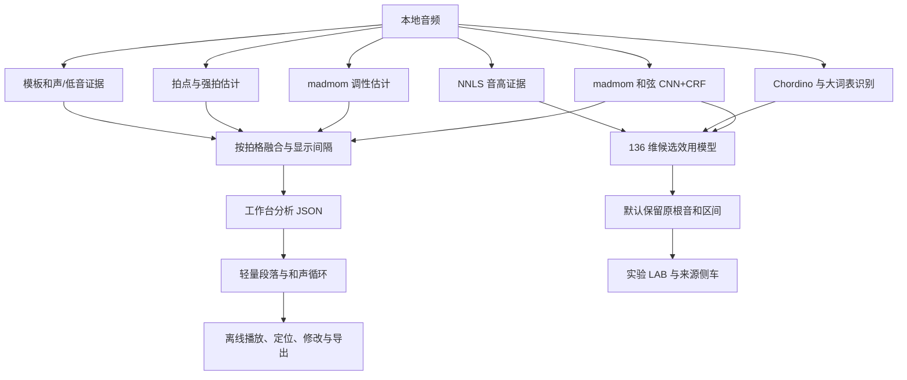

# 当前实现、性能与瓶颈

更新日期：2026-10-06。最新完成和弦审查任务 A 的独立语义/参考规范化；此前 CNN 前三候选排序成绩保持原口径。默认自动策略、前端和冻结模型保持原样。使用方法见 [README](README_chord_recognizer.md)。

## 和弦错误修复 A：语义与参考（2026-10-06）

已阅读新增五份审查材料及附加说明，只实施任务书第一轮 A。[完整说明与复现](benchmarks/reports/chord_error_repair_A_20261006_final/README.md)、[交付索引](benchmarks/reports/chord_error_repair_A_20261006_final/delivery.json)、[原声复核队列](benchmarks/reports/chord_error_repair_A_20261006_final/listening_queue.html)。**这是表示与监督修复，不是模型准确率提升。**

新建 `chord_semantics_v3.py`，保留旧 v2，恢复 `G9sus4 → G:sus4(b7,9)` 等别名、原文/低音/度数。11份对照中的2282个事件有37个语义身份恢复、2245个保持，全部变化都是 `G9sus4`。最新《老男孩》为16个原事件、23.370918秒；审查里的18个是与模型边界交切后的片段，两种计数不能混用。

新建 `reference_events_v1.py`：按显式 `bars.spans` 来源规则导入，`canonical_events` 唯一可编辑；events/spans/beats 同一 revision 派生，拍内多标签保存 segments，不用单一旧 beat 标签替代。编辑支持冲突拒绝及原子保存，仅供独立新参考使用，未改默认页面。旧《老男孩》213/262条视图冲突和ヨルシカ第97小节 E/F#m 冲突保留在诊断；真实16格全部保留，最短约0.11746秒。

根音、性质、七音、扩展与低音分字段掩码；无 slash 不算根音低音，未写扩展不作负例。性质依据展开、删除音后的和弦体，确保 `sus4(b7,9)` 与 `7(9,4,*3)` 的等价写法不产生不同目标。旧 key 先保留为显示/书写坐标，实际 tonic/mode 须明确确认才进入新监督。逐版覆盖见 [监督覆盖](benchmarks/reports/chord_error_repair_A_20261006_final/supervision_coverage.csv)：结构上存在的字段与听辨确认可训练字段分列，当前后者为0，未由 edited/confidence=1 反推可信真值。

《紅蓮華》七处、12.410019秒音集备注/半减七冲突仅掩码七音，未静默改成 dim7。[七处原始区间](benchmarks/reports/chord_error_repair_A_20261006_final/gurenge_conflicts.csv)与其他疑难短句共26条，已从既有音频截取带上下文 WAV；全部仍待听辨。原2675个交切片段中的81个采样精度以下浮点碎片另存原证据，保留2594个有效片段；没有用参考最优偏移移动预测或重算模型分数。

45项针对性测试通过，708个既有源码/权重/契约/人工文件/网页结果哈希保持。新增26次解码仅为试听切片；最终修订按音源/边界/片段SHA复用26条，没有再解码。无声学推理或训练，未重跑历史全套或10首回放。B/C消融留到第二轮；实际音乐复核未完成，不开展大规模训练。《虚拟》既有M1/M2仍G，逐特征C−G贡献已整理，没有重做排序器。

## CNN 前三候选重排序：真实离线训练（2026-10-06）

**完成一轮 M0/M1/M2 的真实拟合，有小幅回顾性开发收益，但 M2 相对 M1 的额外和声价值尚不稳定；未接入默认自动识别。** [完整交付](benchmarks/reports/key_top3_rerank_20261006_v1/delivery.json)、[冻结协议](benchmarks/reports/key_top3_rerank_20261006_v1/protocol.json)、[全部指标/内层搜索](benchmarks/reports/key_top3_rerank_20261006_v1/results.json)。没有新增声学推理、下载或页面扩建，没有开启自动覆盖或修改旧门槛。

### 材料、候选与学习范围

用途登记的 327 条 GiantSteps 逐条核对完整参考、音频/CNN/raw LAB/中性网格/冻结证据哈希和时间支持后，最终 **327 首、275 个连接组，排除 0**。参考仍为既有 major/minor-family 口径：35 大调、292 小调，原始模态亚型和置信等级保留，不是完整音乐调式真值。按全部 368 eligible 记录的艺术家、作品、版本/既有组件及音频 SHA 连接，未入训练的记录也可作为连接桥；分组只用于隔离，不进入特征。

每首固定原 CNN 24 向量的前三个完整主调，升降等价统一、同主音大小调区分；分数相同保持原向量次序。参考不在前三名的 **8 首全部保留**，三候选目标均为 0；候选覆盖 319/327（97.55%）是离线能力上限，不是模型准确率。3 首和声无有效输出的歌曲也保留，以有效性掩码表示缺失；初次准备曾误因缺少 `policy` 排除它们，已在首次真实拟合之前修正并另建最终协议，旧 324 首草稿保留且没有拟合。

M0 选原 CNN 第一名。M1 使用 6 个候选相对特征：CNN 分数、排名、距第一名分差、与下一名分差、同主音另一 mode 分差、候选大小调。M2 使用同样学习器，再加入 13 个全曲和声字段与 13 个有效性掩码，共 32 维：全曲主音/条件调式排名与分差、主音时长/性质对齐、根音/性质拟合及覆盖、结尾、四小节末端弱代理、cadence/pair。

为遵守不使用局部/Viterbi 与循环的边界，适配层从冻结 `centre_score`/条件 mode 分数减去既有 loop 项，主音分数不加 local share，得到明确命名的**全曲证据派生排名**；没有改冻结 v2 的预测、规则或 contract，也没有把这些排名冒称为原 `final_key_candidates` 排名。并列证据共用 competition rank，结构化 12 半音移调检查通过；这不证明声学 CNN 对实际变调音频不变。没有曲名、艺术家、参考、用途、分歧/失败身份或人工状态特征，没有新增交互项。

L2 LR 固定 C 网格 0.1/1/10；每候选权重 1/3，每歌总权重 1，未额外平衡类别。常量零填补、标准化与 LR 均只 fit 对应训练折。内层按完整主调命中最大、误改更少、C 更小选型；预测只在原三个候选中按判别分排序，同分保留 CNN 更高排名。分数未经正确性校准。本轮不搜索部署阈值。

### 同一折外歌曲的实际结果

协议、代码哈希、特征 schema、分组和外/内折号先冻结，再首次真实拟合。外层 5 折、内层 3 折，无降级、无换 seed。主评价是“固定历史引擎条件下的新排序层分组开发评估”；其中 86 首此前参加过 harmonic 权重选择，不能称整条系统无泄漏或新盲测。

附加严格口径将这 86 首所属 **76 个连接组始终留在训练侧**；外层只评价其余 **241 首/199 组**，内层验证也排除这些选择组。它减少指定上游标签曝光，但所有材料仍是已知回顾性素材，K=3 设计本身来自此前 33 首审计，CNN 预训练重叠未知。

| 评价范围 | 模型 | 完整主调 | 主音 | mode | 修正 CNN 错误 | 误改 CNN 正确 | 净增正确 |
|---|---|---:|---:|---:|---:|---:|---:|
| 全体 327 首 | M0 CNN | 267/327（81.65%） | 275/327 | 290/327 | — | — | — |
| 全体 327 首 | M1 CNN 特征 LR | 275/327（84.10%） | 283/327 | 301/327 | 13 | 5 | +8 |
| 全体 327 首 | M2 加全曲和声 LR | 278/327（85.02%） | 284/327 | 302/327 | 14 | 3 | +11 |
| 排除上游选择组的 241 首 | M0 CNN | 196/241（81.33%） | 201/241 | 212/241 | — | — | — |
| 排除上游选择组的 241 首 | M1 | 202/241（83.82%） | 207/241 | 218/241 | 10 | 4 | +6 |
| 排除上游选择组的 241 首 | M2 | 206/241（85.48%） | 210/241 | 224/241 | 16 | 6 | +10 |

全体评价 M2 相对 M1 修正 7、误改 4，净 +3；严格评价修正 7、误改 3，净 +4。按连接组配对重采样 4,000 次，M2−M1 的完整准确率差 95% 探索性区间分别为 **−0.95～+2.92、−0.84～+4.17 个百分点**，均跨零。重采样未建模交叉验证训练重叠，不是部署风险保证。

| 范围 | 外层折 | 歌曲数 | M0 命中 | M1 命中 | M2 命中 |
|---|---:|---:|---:|---:|---:|
| 全体 | 0 | 66 | 51 | 52 | 54 |
| 全体 | 1 | 66 | 54 | 57 | 57 |
| 全体 | 2 | 65 | 53 | 55 | 55 |
| 全体 | 3 | 65 | 53 | 54 | 54 |
| 全体 | 4 | 65 | 56 | 57 | 58 |
| 严格 | 0 | 49 | 38 | 37 | 39 |
| 严格 | 1 | 48 | 41 | 41 | 44 |
| 严格 | 2 | 48 | 39 | 39 | 39 |
| 严格 | 3 | 48 | 41 | 45 | 45 |
| 严格 | 4 | 48 | 37 | 40 | 39 |

**不能隐藏少数类退步。** 全体大调命中 M0/M1/M2=20/18/20（分母 35），小调=247/257/258（分母 292）；严格口径大调=16/14/15（分母 27），小调=180/188/191（分母 214）。M1 两次大调均退步，严格 M2 大调比 CNN 少 1 首。完整指标也包含“主音正确条件下的 mode”，其分母为实际主音命中数，不能与全体 mode 准确率混用。

两路原本一致的全体 191 首，M0/M1/M2=172/175/172；原本分歧的 136 首=95/100/106。原本一致但共同错的 19 首未被删除，M1 修正 3 首、M2 修正 0 首。严格口径一致 145 首=130/133/131，分歧 96 首=66/69/75；一致共同错的 15 首上 M1/M2 修正 3/2。和声特征的收益未覆盖所有决策场景，不能据此新增“一致直接接受”的硬规则。

逐曲折外预测、每组/每种错误关系、纠正/误改/错转错名单、各折模型和全部内层 C 选择保存在输出目录。[主评价 CSV](benchmarks/reports/key_top3_rerank_20261006_v1/all_retired_grouped_oof.csv)、[严格 CSV](benchmarks/reports/key_top3_rerank_20261006_v1/upstream_selection_groups_training_only_oof.csv)。此前 33 首在本轮是明确标记的**新排序层组外预测、已知回顾性记录**：全体口径 M0/M1/M2=26/26/26，严格口径=26/26/27，不重新称“新封存”。

### 《虚拟》、验证与停止结论

全部选型完成后，各模型按预先声明的内层 C 票数规则在全部 327 首拟合，仅用于已知回归；M1 最终 C=10，M2=0.1（票数并列取更强正则）。《虚拟》、Beatles17 和工作台待审核记录均未进入训练/选型。《虚拟》原 CNN 前三为 **G/C/Em**，M1 与 M2 均仍排序 **G/C/Em**；M2 的 C−G 分差较 M1 更接近，但没有选对 C，不能算自动纠错。候选判别分与逐字段贡献见 [回归结果](benchmarks/reports/key_top3_rerank_20261006_v1/xuni_regression.json)，两次独立 CLI 结果与其完全一致；没有为本曲改参数或改网页。

21 项本轮必要测试通过，无失败/跳过。独立审计 20 个外层模型、180 次内层训练身份、20 次选型，重算训练折标准化均值/尺度与保存模型的全部外层预测，内外组交叉为零；8 首候选漏召回和 3 首和声不可用均保留。2,018 个受保护源码/权重/历史制品/工作台及人工 JSON 哈希未变，没有回放历史 256 项或 10 首旧输出。依赖 sklearn 1.8.0、NumPy 2.4.4；真实 LR 拟合共 202 次，训练/评价阶段墙钟 8.65 秒、CPU 7.88 秒、2 数值线程，进程峰值工作集 181.50 MiB（OS 记录，非全机物理内存峰值；不含准备与前置哈希核验）。新声学推理、冻结符号分析、下载均为 0。

**结论：保留有限候选重排序这一研究方向；当前全曲和声的额外价值未得到稳健证明。** 已保留两种评价、误改、少数类和一致共同错误的负结果。本轮到此停止，不追加规则/模型/网格、不选择部署阈值；下一步需要目标流行/民谣材料和独立分组评价。新增独立校准/测试标签仍为零，不能承诺目标曲风泛化或默认自动覆盖。

## 全曲主调辅助审阅与数据准备（2026-10-06）

Web 工作台新增独立“和声主调 v2 · 辅助审阅”开关。读取原始 madmom LAB、中性时间网格及冻结 contract；核对音频、LAB、必要中性输入、实现身份后复用冻结缓存。新输入仅在必要时调用冻结符号分析器，不重新做声学识别。现有 `fused` 策略未替换，和弦 v2 与主调 v2 不混用。

《虚拟》真实项目已启用审阅：**原自动 G、全曲建议 C、未人工确认、无自动覆盖**。采用建议或自定义主调保存运行级人工事件，跨和弦来源统一级数；新浏览器会话可恢复，撤销回到原自动 G。原始 CNN/v2 证据、绝对和弦标签、已保存的和弦修改保留。修订号/运行/音频身份防止旧窗口覆盖；不能即时重算的原调性派生分析显示过期。引擎 `resolved` 与人工确认分开，分数未经校准。全曲候选、原始分项及加权贡献可展开；旧/新局部时间线均默认折叠为“局部调性候选 · 未验证”，只定位播放，不自动改调或切换小节级数。

只读 [候选审计](benchmarks/reports/key_review_data_20261006/candidate_audit.json) 核对已知 33 首：两者都对 15、仅 CNN 对 11、仅 v2 对 2、两者都错 5。预测一致 19、不一致 14；双方都错中有 4 首预测一致、1 首不同。2 个互补、11 个误改风险和 5 个共同失败的完整真实证据全部导出，不能只看成功样例。

| 候选覆盖（不是 top1 准确率） | CNN | harmonic v2 |
|---|---:|---:|
| top1 | 26/33 | 17/33 |
| top2 | 31/33 | 22/33 |
| top3 | 32/33 | 28/33 |
| top6 | 32/33 | 30/33 |

固定 top3 并集为 32/33，实际候选 3–6 个、均值 4.15；逐曲匹配并集实际数量的单来源对照为 CNN 32/33、v2 29/33。因此没有证据把扩大候选数包装为识别提升。两首互补的正确参考都已在 CNN 第二名。五首共同失败均非 top1 主音正确而仅 mode 错；其中 2025670 的参考为 Cm，CNN 排名 7、v2 排名 14，在有限并集之外。五首输入哈希及缓存时间支持通过，未重新听辨其参考正确性。v2 保留全部 12 主音、24 完整调；排序为先主音再条件 mode，没有不可逆删除候选，不等于跨来源分数可直接相加。

Billboard 原口径 TP/FP/TN/FN=65/443/228/2：**假阳性率 66.0%、报警精确率 12.8%、检出率 97.0%**。仅评价“是否有参考主音变化”，缺音频、完整 mode 与精确转调边界真值；不将候选隐藏当作误报率改善。开发/校准的循环与 local/Viterbi 未增加完整主调命中的负消融保留。

[材料盘点](benchmarks/reports/key_review_data_20261006/data_inventory.json) 登记 335 条、334 个音频 SHA，提出 282 个连接组件（别名/未列版本未完全核验）；已有 327 条 GiantSteps 标注仅作退役开发材料，另 8 条用户/工作台记录待人工审核，其中包含相同音频的两条记录。作品数按已声明作品或音频 SHA 回退统计，不宣称全部已认证独立。另核实 Beatles 83 份、GuitarSet 178 份现有音频及对应和弦参考；不是新目标曲风完整主调金标准。Billboard 不填入端到端裁决器训练行。**新增独立校准/测试条目均为 0**。

新增 [用途 JSONL](benchmarks/reports/key_review_data_20261006/data_roles.jsonl)、CSV、[人工审阅队列](benchmarks/reports/key_review_data_20261006/review_queue.json)、缺口清单及 [数据协议](benchmarks/reports/key_review_data_20261006/DATA_PROTOCOL.md)。历史 split 不改；已知材料的新用途与历史用途分开记录。目标难例池与未来代表性校准/测试池分开，不能搬封存正例开启门槛。新“先听辨再看建议”页面支持录音版本、时段、未知 mode、多调/歧义、听辨依据、锁定与预测曝光修订；导入接口拒绝未经隔离审计直接指定校准/测试。此流程仅隐藏本页预测，不自动证明之前未见预测；采用建议不自动升级为金标准。

验证：42 项针对性测试通过；真实 HTTP 服务 + Edge、真实冻结音频/结果的 13 类工作台检查通过，无响应拦截、无 JS 错误，包括采用 C、独立浏览器会话恢复、恢复 G、409 冲突、和弦编辑保留、实际播放及 390px 排版。使用隔离副本验证人工写入，真实用户项目仍为 G/未确认。CLI 单曲符号输出与冻结预测对象一致。1,955 个受保护源码/权重/契约/历史制品哈希未变；没有重新签名历史报告。**新声学推理 0、训练 0；未重跑历史 256 项或 10 首旧预测。** 完整命令、哈希、逐曲证据、测试、截图、资源与限制见 [本轮交付](benchmarks/reports/key_review_data_20261006/delivery.json)。

以下为历史冻结实验结果；上述 33 首从本轮起是已知诊断，不能用于调参后继续称为该新方案的独立封存验证。

## 和声主调分析器 v2：冻结实验（2026-10-06）

**本轮独立重构和声主调分析器，未修改默认工作台、CNN、和弦模型或裁决器。** 新封存 33 首：harmonic v1 4/33 → v2 17/33；CNN 26/33。CNN∪v2 离线候选上限为 28/33。自动裁决仍禁用，本轮没有训练 resolver。

[完整交付与哈希](benchmarks/reports/harmonic_key_v2_20261006/delivery.json)；[冻结参数、代码 SHA 与全部选模/消融结果](benchmarks/reports/harmonic_key_v2_20261006/engine_contract.json)；[新封存逐曲结果](benchmarks/reports/harmonic_key_v2_20261006/harmonic_new_sealed.csv)。

### 根因与新实现

旧 `detect_key_timeline.py` 的基础拟合给大调 I/IV/V 1.25、vi 1.05，而小调对应匹配为 0.95；自然小调第 V 根音只期待大三和弦，错误压低自然 v。后续 `score_key` 无条件给小调扣 0.12，主音时长/开头分支仅处理大调，并将大调 pair/loop 用于小调。`m7b5` 也先被当成 minor。这些不对称共同解释旧版的大调吸引。原代码保留作对照。

`app/harmonic_key_v2.py` 先比较 12 个 tonic，再在每个 tonic 内分别比较 major/minor；JSON 同时保存 `tonic_candidates`、`mode_candidates_by_tonic`、`final_key_candidates`。根音匹配、性质匹配、功能级数与时长分离；兼容性没有固定大小调加减分。小调自然 v 与和声小调 V/导音减和弦共存，借用和弦给软支持，未知/sus 性质被掩码。

大小调各有终止式、pair 与循环证据，循环按全部旋转归一化；不跨 N/X 空白制造终止式或循环。主音时长是软证据。8 小节/4 小节步长局部窗口，用 12 主音 Viterbi 平滑，再条件判 mode；局部证据与全曲共享和弦，不能当成独立投票。4 小节末端只是弱乐句代理，不代表已识别主歌/副歌。

[24 调 × 12 根音 × 7 性质的 2016 项兼容表及旧版探针](benchmarks/reports/harmonic_key_v2_20261006/compatibility.json)。固定 [Krumhansl-Kessler chroma profiles](https://essentia.upf.edu/reference/std_Key.html) 作为独立诊断，沿用原 22050 Hz 解码、centered fast chroma、hop=512，用精确时长帧权重。来源内分数不是概率，也没有接入 resolver。

### 数据、选择与冻结

在全部 368 条 eligible GiantSteps+ 上重建艺术家/混音者 ID、名字与作品连接组件。旧 180 首及与其相连的 41 首一并排除，剩余 147 首在推理前按组冻结：开发 86 首/76 组（8 大调、78 小调），校准 28 首/23 组（4/24），新封存 33 首/27 组（4/29）。与旧组及跨新划分交叉为零；147 份音频 SHA 彼此唯一，且不与旧 180 重合。别名/未列录音版本与 CNN 上游预训练成员无法穷尽核实。

只在开发集预先声明的 12 组 duration/cadence/loop 权重中选择，目标依次为大小调均衡完整准确率、最弱类准确率、总体准确率；并列按固定网格顺序。校准只检查、不回选。代码 SHA/schema/全部门槛和参数已写入 contract，才首次读取新封存成绩。新封存结果之后没有调规则或门槛。

开发选中的主音时长权重 0.2、终止权重 0.15、循环权重 0.1；其余固定值见 contract。review margin 0.03 为工程拒判提示，未经过概率校准。参考采用既有接受的 major/minor-family 口径，保留原始模态亚型；不是对完整音乐调式的评估。

### 新封存结果

| 来源 | 主音 | 调式 | 主音正确条件下调式 | 完整主调 | 大调命中/4 | 小调命中/29 | 预测大/小/缺失 |
|---|---:|---:|---:|---:|---:|---:|---|
| cnn | 81.8% | 87.9% | 96.3% | 26/33 (78.8%) | 2 | 24 | 4/29/0 |
| harmonic_v1 | 33.3% | 12.1% | 36.4% | 4/33 (12.1%) | 3 | 1 | 31/2/0 |
| chroma | 42.4% | 66.7% | 64.3% | 9/33 (27.3%) | 1 | 8 | 15/18/0 |
| harmonic_v2 | 66.7% | 66.7% | 77.3% | 17/33 (51.5%) | 2 | 15 | 11/22/0 |

| 来源 | 五度邻调 | 关系大小调 | 同主音大小调 | 其他/缺失 |
|---|---:|---:|---:|---:|
| cnn | 1 | 1 | 1 | 4 |
| harmonic_v1 | 0 | 11 | 7 | 11 |
| chroma | 8 | 1 | 5 | 10 |
| harmonic_v2 | 5 | 2 | 5 | 4 |

混淆分类：五度邻调要求同大小调族、主音距离 ±7 半音；关系大小调与同主音大小调分别计数。主音正确条件下的调式准确率分母仅为主音命中的歌曲。

- `cnn ∪ harmonic_v2` oracle：28/33（84.8%）。
- `cnn ∪ chroma` oracle：26/33（78.8%）。
- `cnn ∪ harmonic_v2 ∪ chroma` oracle：28/33（84.8%）。

CNN 错误中 v2 新提供 2 个正确候选；CNN 正确而 v2 错误有 11 首。这是独立分支差异，不是已发生的自动覆盖。离线互补前置条件达到；可以作为后续研究依据，但当前校准与曲风覆盖仍不足，本轮不训练/部署裁决器。oracle 只用于离线评估，不进入推理特征。

新校准集共 10 首 CNN/v2 分歧，正确性支持 `{'cnn_correct': 9, 'cnn_incorrect': 1, 'harmonic_correct': 0, 'harmonic_incorrect': 10, 'both_incorrect': 1}`。这是后续门控可用性诊断，没有用这些数值挑门槛。

**目前仍不建议重训并校准自动裁决器。** 新封存的两个互补样本证明分支已有潜在价值，但不能拿它们回补本轮开发/校准后继续宣称同一封存验证；新校准仍没有和声纠错正例。下一阶段需要额外独立、跨风格且有纠错正负例的开发/校准材料。

### A–G 消融（仅新开发/校准）

| 划分 | 阶段 | 大调完整准确率 | 小调完整准确率 | 总体完整准确率 |
|---|---|---:|---:|---:|
| dev | A_fit | 0.0% | 30.8% | 27.9% |
| dev | B_duration | 50.0% | 53.8% | 53.5% |
| dev | C_cadence | 50.0% | 52.6% | 52.3% |
| dev | D_loop | 50.0% | 52.6% | 52.3% |
| dev | E_ending | 62.5% | 52.6% | 53.5% |
| dev | F_local | 62.5% | 52.6% | 53.5% |
| dev | G_full | 75.0% | 53.8% | 55.8% |
| calibration | A_fit | 0.0% | 25.0% | 21.4% |
| calibration | B_duration | 50.0% | 45.8% | 46.4% |
| calibration | C_cadence | 50.0% | 45.8% | 46.4% |
| calibration | D_loop | 50.0% | 45.8% | 46.4% |
| calibration | E_ending | 50.0% | 58.3% | 57.1% |
| calibration | F_local | 50.0% | 58.3% | 57.1% |
| calibration | G_full | 50.0% | 58.3% | 57.1% |

A=fit，B=主音时长，C=pair/cadence，D=循环，E=结尾，F=局部/Viterbi，G=弱开头证据。负消融与全部 12 组开发分数均保留在 contract，没有用封存成绩挑阶段。

### 已知回归与 Billboard

| 已知音频 | CNN | harmonic v1 | chroma | harmonic v2 |
|---|---:|---:|---:|---:|
| giantsteps180 | 145/180 | 13/180 | 62/180 | 112/180 |
| beatles17 | 14/17 | 14/17 | 14/17 | 15/17 |
| xuni | 0/1 | 1/1 | 1/1 | 1/1 |

《虚拟》冻结后：CNN `G`，chroma `C`，harmonic v1 `C`，v2 `C` / `resolved`。v2 主音前三为 `[('C', 1.0543), ('A', 1.0092), ('D', 0.8415)]`，分差 `{'tonic': 0.045155408387691054, 'conditional_mode': 0.7437748231960691}`；局部可判定 110/126 小节，主音占全部有效小节 `{'C': 0.3333333333333333, 'A': 0.5079365079365079, 'F': 0.031746031746031744}`。各调条件性质/时长/终止/循环成分与逐窗口原证据保存在 [虚拟完整回归](benchmarks/reports/harmonic_key_v2_20261006/regressions/xuni/report.json)。用户确认 C 是本曲参考，没有据此更改规则。默认仍显示 CNN/旧裁决器的暂定 G，独立实验不会自动修改网页。

旧 180（含旧 sealed24）、Beatles17 与《虚拟》全部为已知回归，原 CNN/LAB/grid 缓存复用，没有重新声学推理。逐曲改善/退步名单在 delivery，不能称为新盲测。

《虚拟》全曲 C 的具体优势来自主音和弦时长 21.9%（A 为 15.0%）、结尾落 C、四小节末端 C 支持 32.3%（A 为 19.4%），以及略高的性质拟合。C 的终止式计数实际为 0，A 为 6，不能解释为检测到了强 V→I。局部可判定部分 A 占 64/110、C 占 42/110；相对调窗口多义仍然明显，`resolved` 只代表工程分差通过，不能当作置信保证。

Billboard：738 首成功、1 首失败；主音 75.3%（旧 73.0%），局部时长主音 65.1%；supported 局部准确率 67.9%、覆盖 76.2%。改善 130、退步 113。变化检出计数 `{'reference:False predicted:True': 443, 'reference:False predicted:False': 228, 'reference:True predicted:True': 65, 'reference:True predicted:False': 2}`。

这是旧已知的参考和弦 + 段落插值网格 → tonic 符号诊断；没有原音频和独立 mode 真值。没有计算大小调准确率，没有从和弦生成 mode 真值再循环打分。转调只比较“是否有变化”，不验证精确边界。失败原件保留，见 [Billboard 逐曲及失败](benchmarks/reports/harmonic_key_v2_20261006/billboard.json)。

**局部转调仍明显不可靠：无参考转调的 671 首中误报 443 首（66.0%）。** 全曲主音略升不能掩盖这项失败，不应将局部时间线或 supported 标签当作可信段落/转调标注。

### 仍未解决的性能瓶颈

消融显示主音时长带来主要改善；cadence 在开发集反而减少 1 首命中，循环和 local/Viterbi 在开发/校准的完整准确率均未增加。结尾证据在校准有收益，弱开头在开发有收益，但小样本不能证明跨风格稳健性。局部多义和弦会在相对调之间换锚，当前平滑与 margin 不能充分抑制假转调。

新封存中 v2 有 5 首同主音大小调错误、5 首五度邻调错误；条件调式仍弱于 CNN。chroma 只命中 9/33，且没有为 CNN 新增正确候选，不能因为它在单曲上成功就加入自动裁决。参考和弦条件下的 Billboard 主音也未接近满分，说明乐理中心判断与声学输入两侧都仍有损失。

### 验证、资源与限制

- 针对性测试 50 passed；失败 0、错误 0、跳过 0。包含全调移调性质、大小调循环全部旋转、自然/和声小调共存、根音/性质分项、未知/空白、时间网格、局部唯一小节归属、主音/mode 指标与封存读取隔离。未重跑历史 256 项或 10 份旧预测。
- 新声学分析 147 首，总时长 4.90 小时，4 个 worker；fixed chroma 147 首及已知回归 198 首。冻结前补齐静音输出时长字段，使 147 份 profile 缓存重算一次，共 492 次提取、345 个不同输入。没有新 CNN/HGB/LR 训练，只有声明过的规则系数选择。
- 音频进程树采样 RSS 峰值 1.96 GiB；采样从批次开始后启动，RSS 汇总可能重复计算共享页，不是全机物理内存峰值。实际阶段命令与耗时见 commands.json；轮询耗时含最多约 10 秒观察间隔。
- 所有受保护实现、resolver 门槛、冻结 v1/v2 权重/contract 哈希一致。未回放旧输出。
- 新封存与校准各只有 4 首大调，主要为 EDM；广泛跨风格、新录音版本、可信置信校准尚未完成。上游 CNN 预训练重叠未知。
- 本轮未验证和弦/低音/扩展音、声学边界或主歌/副歌准确率。局部证据仍可能混淆相对调、循环多义和借用和弦；固定弱先验不等于完整调性语法。

所有来源评价同一整曲解码时间支持。raw 空白被排除；输入音高/性质覆盖、窗口与可判定小节见 [输入诊断](benchmarks/reports/harmonic_key_v2_20261006/input_diagnostics.json)。此处候选上限仅使用各来源 top1 并集；枚举全部 24 调的 oracle 会平凡地等于 100%，不报告为能力。没有参考和弦边界，不能给出声学分段上限。

### 可执行入口

```powershell
python app/harmonic_key_v2.py --raw raw.lab --neutral neutral_analysis.json --contract benchmarks/reports/harmonic_key_v2_20261006/engine_contract.json --output harmonic_v2.json
python app/key_profile_baseline.py song.mp3 --output profile.json
python app/evaluate_harmonic_key_v2.py evaluate --split benchmarks/reports/harmonic_key_v2_20261006/split.json --acoustics benchmarks/reports/harmonic_key_v2_20261006/acoustics --profiles benchmarks/reports/harmonic_key_v2_20261006/profiles --contract benchmarks/reports/harmonic_key_v2_20261006/engine_contract.json --phase harmonic_new_sealed --output key_evaluation.json
```

评估重跑只读取冻结缓存；不得在修改后沿用旧 contract。选模入口拒绝覆盖已存在 contract。完整实际运行 argv、输入/权重 SHA、逐曲/曲风成绩、消融与退步名单见交付 JSON。

以下为此前裁决器实验的历史结果；其中旧 180/旧 sealed24 如今均视为已知回归，不是本轮新封存成绩。

## 实验主调融合（2026-10-06）

**本轮没有提高准确率；已完成统计修复、真实训练和校准可用性检查，自动分歧裁决因校准类别不足而禁用。** 封存 24 首上 CNN 为 70.8%，raw harmonic 仅 12.5%，新裁决器含暂定答案的准确率为 70.8%，纠正 0 首、误改 0 首。《虚拟》本轮输出 **G / ambiguous**。仍保持 experimental，不替换默认 CNN，不根据这些结果回调门槛。

完整交付：[delivery.json](benchmarks/reports/key_resolver_20261006/delivery.json)；[实际执行命令与时间](benchmarks/reports/key_resolver_20261006/execution.json)。音频、权重、特征实现、split、逐曲输入与结果均可追溯。旧 v1 共识结果继续保存在 [上一轮索引](benchmarks/reports/key_fusion_20261006/delivery.json)，不覆盖历史评分。

### 统计定义与实现

旧 `stable_coverage = 支持候选的小节 / 全部有效小节` 衡量的是总覆盖；它本身没有算错，但单独用于判断候选是否占优势，会把“不知道”与“明确支持竞争者”混在一起。新字段同时保存：

- `valid_bars`：有足够音高覆盖且分配到唯一窗口的小节；另记 measured/excluded，不把缺失音频支持伪装成反对。
- `decisive_bars`：通过既有局部分差条件的小节；`unresolved_bars = valid - decisive`。
- `decisive_coverage = decisive / valid`，`unresolved_coverage = unresolved / valid`。
- `candidate_decisive_share = 候选稳定小节 / decisive`；旧 `stable_coverage` 保留。
- 最大竞争调的小节数、以 valid/decisive 为分母的两种占比；`candidate_vs_competitor_gap = (候选数 - 最大竞争者数) / decisive`。分母为零时返回缺失值及特征有效性掩码。

《虚拟》仍是 126 个有效小节，84 个可判定、42 个未判定：可判定覆盖 66.7%，未判定 33.3%；C 在可判定部分占 64/84=76.2%，全部有效小节占 64/126=50.8%；最大竞争者 G 为 18/126=14.3%，在可判定部分占 21.4%。C−G 的 decisive gap 为 46/84=54.8%。这些是描述指标，不是按本曲选出的门槛。

`app/key_disagreement.py` 将 CNN 与 raw harmonic 定义为主证据；functional_joint、局部时间线、终止、循环仅为辅助特征。主证据完整、唯一且达到原输入质量要求时，一致直接接受；分歧才调用两个逻辑回归 correctness gate，分别预测 CNN/harmonic 是否正确。恰好一个 gate 通过才裁决；两者均通过/均不通过则 ambiguous。人工调性始终优先。

特征共 135 项（含有效性掩码），只使用来源内分数/排名/分差、I/V/II/IV 时长、终止与循环统计、decisive/竞争者支持、联合分析排名及五度/关系大小调等关系。没有曲名、艺术家、参考或数据集身份；不直接相加不同来源分数。LR 判别分数不是已校准的正确概率。

CLI `--key-source fused` 与网页“分歧裁决 · 实验”已接入；默认仍为 `madmom`。新 schema 为 `key_disagreement_resolver_v2` / `key_conflict_features_v2`；旧策略留在 `legacy_policy` / `legacy_gate_checks`。模型加载校验四个特征实现文件哈希，推理还核对 CNN 权重；改变特征语义必须重建证据并重训。两套前端展示两种支持率及未判定比例，保留人工改调、级数、播放定位。

### 数据与冻结划分

[GiantSteps+ 官方记录](https://zenodo.org/records/1095691)，DOI `10.5281/zenodo.1095691`，记录许可证 CC BY-SA 4.0。下载完整 600 首音频包；855,761,126 bytes，官方 MD5 验证通过，SHA256 `34abdc154a44022348a5f14e30138a39efac395299bf09eab9458e68a844ee27`。它与 Beatport/MTG 记录 1101082 不同。早期镜像与官方音频字节不同，已统一到官方包并按音频 SHA 作废旧缓存；不混用两套输入。

600 条中 368 条具备本试点接受的单一 major/minor-family 标注；排除多调、未知、失谐和置信度 0/缺失。先按 seed 20261006 和 ID 哈希固定抽取 180 条，再进行任何推理：开发 **134**、校准 **22**、封存 **24**，147 个艺术家/混音者/作品连接分组，跨 split 分组交叉为 0，音频 SHA 无重复。模态亚型保留原始标签，仅映射其标注明示的大小调族；157 条 confidence=2、23 条=1。含 14 个电子音乐类别，不能代表已覆盖广泛流行/摇滚风格。

[冻结 manifest](benchmarks/reports/key_resolver_20261006/splits/giantsteps_split.json)、[标注覆盖](benchmarks/reports/key_resolver_20261006/splits/coverage.json)、[来源/许可证/下载 SHA](benchmarks/external_key_data/corpus_downloads.json)。本轮 resolver 的训练/校准/封存隔离已实施，但没有逐首核实本地 CNN 权重的上游预训练成员，不能称为整个声学系统完全未见的盲测。

### 训练、校准与封存成绩

仅开发分歧样本训练：**125** 条；校准分歧 **20** 条。两个 LR 使用标准化、C=1、balanced 权重；预先要求每头至少 20 条开发分歧、正负各 5 条，校准至少 12 条分歧且正负各 3 条，否则自动门槛禁用。实际校准支持见模型 `calibration_support`。只在校准集按“最少误改 → 最多纠正 → 最少已裁决错误 → 最大覆盖”选择门槛，未按封存或回归结果选择。

**实际未达到可用校准条件：** 20 条校准分歧中 CNN 正确 19、错误 1；和声正确 0、错误 20。两个头均缺少足够的某一类别，因此没有可用的冲突门槛。这不能包装成已完成可靠概率校准。开发集和声头也只有 5 条正例/120 条负例，虽达到预先设定的最低训练条件，泛化依据仍很弱。

冻结 gate 门槛：CNN **1.01**、harmonic **1.01**（1.01 表示禁用）；纯规则对照参数 `{'coverage': 1.01, 'dominance': 1.01, 'gap': 1.01}`。完整门槛搜索及类覆盖保存在 [模型](benchmarks/reports/key_resolver_20261006/resolver.json)。模型 SHA256：`9b192a99d21b616ad574a9b3304690e9c1e347f11830c375feb2cb18fb2d2332`。`benchmarks/models/key_resolver_v2.json` 是同字节的实验副本；CNN、冻结和弦 v1/v2 均未重训。

封存集 24 首，同一完整音频窗口、24 类精确匹配。**准确率包括 ambiguous 时保留的 CNN 暂定答案**；自动覆盖与拒判率另列。CNN/raw baseline 有候选时给出其 top1，其“已裁决”不表示置信保证。

| 方法 | 全局准确率 | 自动裁决覆盖 | 已裁决但错误/24 | CNN 错→对 | CNN 对→错 |
|---|---:|---:|---:|---:|---:|
| CNN | 70.8% | 100.0% | 7 | 0 | 0 |
| raw harmonic | 12.5% | 100.0% | 21 | 0 | 14 |
| 两个 LR gate | 70.8% | 20.8% | 2 | 0 | 0 |
| 校准纯规则 | 70.8% | 20.8% | 2 | 0 | 0 |
| 仅接受主证据一致 | 70.8% | 20.8% | 2 | 0 | 0 |

新裁决器拒判率 79.2%；已裁决错误占全部 8.3%，占已裁决部分 40.0%。不存在只报告最佳均值的选择。开发、校准、封存以及 per-genre 完整结果分别在同目录 JSON 中。

封存中接受的 5 个一致结论有 2 个错误；“CNN 与和声一致”也不足以证明可信。这是保留 experimental 的实证原因，而不只是样本量小。

| 封存混淆 | 五度邻调 | 关系大小调 | 同主音大小调 | 其他 |
|---|---:|---:|---:|---:|
| CNN | 3 | 2 | 0 | 2 |
| raw harmonic | 1 | 10 | 5 | 5 |
| resolver | 3 | 2 | 0 | 2 |

[逐曲及分曲风结果](benchmarks/reports/key_resolver_20261006/sealed_test.json)、[逐曲 CSV](benchmarks/reports/key_resolver_20261006/sealed_test.csv)、[完整 24×24 混淆矩阵](benchmarks/reports/key_resolver_20261006/sealed_test_final_confusion.csv)（CNN/raw 矩阵在同目录）。[每次自动覆盖的分数、门槛、原因及证据](benchmarks/reports/key_resolver_20261006/overrides.json)包含开发、校准、封存与回归，明确区分数据用途。

封存中两路 top1 至少一方正确的上限为 70.8%，两路都错 7 首；仅在两者间裁决无法恢复其真实主调。错误按路径拆为 `{'ambiguous': 5, 'agreement': 2}`。这是[离线候选上限诊断](benchmarks/reports/key_resolver_20261006/diagnostics.json)，没有进入推理特征或选模。

### 冻结后的已知回归

Beatles17：CNN 14/17；新裁决器 **14/17**，ambiguous **5/17**（旧版为 13/17），纠正 0、误改 0，已裁决但错误 0。这 17 首及《虚拟》仅用于回归，没有进入训练、门槛搜索或模型选择。复用可追溯的原 CNN/raw/neutral，不重复运行声学模型。

待审核减少来自“主证据一致即接受”的路径调整，不是学习门控带来了纠错；不能把覆盖率变化宣传成准确率提高。

| 重点歌曲 | 参考 | CNN | harmonic | 最终 | 路径 |
|---|---|---|---|---|---|
| Money | E | Em | E | Em | ambiguous |
| Taxman | D | C | G | C | ambiguous |
| Girl | D# | Cm | D# | Cm | ambiguous |

[17 首逐曲结果](benchmarks/reports/key_resolver_20261006/beatles17.csv)及 [完整证据](benchmarks/reports/key_resolver_20261006/beatles17.json)。升降号统一为 pitch-class 等价记法，例如 D# 对应 Eb。

《虚拟》参考 C 来自用户确认；CNN G、raw harmonic C、辅助 joint C。冻结裁决器最终 **G / ambiguous**，原因：`Neither gate or both gates passed; no unique resolution`。两头分数 `{'cnn': 0.3864080627300367, 'harmonic': 0.000582356662404316}`。若仍为 ambiguous，就继续如实保留暂定答案，不为此曲调阈值。[本轮完整证据](benchmarks/reports/key_resolver_20261006/xuni_evidence/000.json)；音频 SHA256 `d4867eec9bec73fb4dbf0575cff26e3e6550cdba9553c8f886b3a4adab6ef72f`。

### Billboard 与剩余瓶颈

[McGill Billboard 官方页面](https://ddmal.ca/research/The_McGill_Billboard_Project_%28Chord_Analysis_Dataset%29/)提供 CC0 标注；本轮只下载 chord/tonic/structure，不下载或假定有原始商业音频。按作品/艺术家隔离、去掉重复榜单条目后，738 首成功，1 首官方 LAB 存在实质逆序而保留失败。开发 490、校准 126、封存 122。

这是**参考和弦 + 由段落插值的小节网格 → 主音**的符号上限诊断，不是 raw 音频识别或完整大小调准确率，也没有用它训练 CNN 裁决器。封存主音准确率 71.3%，五度邻调错误 14 首；局部主音时长准确率 65.6%，仅已支持局部段为 68.8%、覆盖 90.5%。有主音变化的 16 首检出 11 首、漏 5 首；无变化的歌误报 24 首。此处只衡量“是否存在变化”，不衡量精确转调边界。[逐曲及失败记录](benchmarks/reports/key_resolver_20261006/billboard/report.json)。

当前真正瓶颈仍包括：既有和声 pair/loop/开头先验偏大调、循环旋转敏感；局部时间线假转调较多；外部音频主要为 EDM，流行歌曲域外裁决不可靠；校准与封存数量小。Billboard 缺乏可直接使用的 mode 真值，不能评估关系/同主音大小调；借用和弦识别与语料上的循环旋转指标尚未完成。和弦/低音/边界/段落性能本轮没有新声学准确率结论。

新增的[跨曲风失败诊断](benchmarks/reports/key_resolver_20261006/harmonic_domain_diagnostic.json)明确显示大调偏置：开发参考 120/134 首小调，和声却给出 126 首大调、6 首小调、2 首缺失；校准 21/22 首小调而预测全为大调；封存 20/24 首小调而预测全为大调。手工可核验的旧 `chord_fit` 中，Am 匹配 Am 为 0.95、匹配 C 为 1.05；自然小调的 Em 匹配 Am 仅 0.20、匹配 C 为 0.95。单个和弦不能唯一确定主调，但这证实了打分的不对称性。

只用已缓存的 duration-weighted chord fit、去掉后续功能先验，作为冻结后的单因素定位：开发 10/134、校准 0/22、封存 5/24（并列时拒判）；既有完整规则为 9/134、1/22、3/24。基础拟合与后续先验都需要进一步审查，不能只怪某一个覆盖门槛。此诊断没有修改规则、重新选模型或部署该对照。

### 验证与资源

- 针对性测试 **78 passed，1 xfailed**；xfail 是保留的旧 v1《虚拟》自动 C 用例，不是新模型的成绩。[记录](benchmarks/reports/key_resolver_20261006/tests.txt)。未重复历史 256 项及 10 份逐字节预测复现。
- Edge/Playwright 用本轮冻结后的真实《虚拟》证据验证主调、两种支持率、人工改调/恢复、级数切换、局部播放定位、390px 布局及无 JS 错误。测试拦截结果 JSON 以保护旧项目，音频播放使用本机服务；这不是重新上传音频的全链路测试。[记录](benchmarks/reports/key_resolver_20261006/ui_actual_frozen_result.log)。
- 新声学推理：官方包 **180 首**，实际解码总长 5.99 小时；新训练仅两个 LR 头。Beatles17/《虚拟》复用缓存。没有重新训练 CNN、HGB 或新跑 Chordino/大词表。
- 最终批次采用 6 个受限 worker；按采样观测的进程树 RSS 峰值约 **3.26 GiB**，并非全机物理内存峰值，采样从批次启动后约 6.7 分钟开始。完整下载、镜像失效重算的耗时不包含在最终批次耗时中。[资源记录](benchmarks/reports/key_resolver_20261006/archive_resources.json)、[每阶段实际耗时](benchmarks/reports/key_resolver_20261006/execution.json)。
- 冻结和弦 v1/v2 权重与 contract SHA 和上一轮完全一致；此次仅校验哈希，不重复旧预测重放。证据采样、边界和候选数值策略未因测试歌曲改变。

目前不足以将 fused 设为默认。下一轮需要新的跨风格开发/校准数据以及新的封存集；本轮封存集从现在起只能作为已知回归，不能继续用它挑门槛。

## 1. 当前结论

项目已经具备完整的“本地音频 → 自动和弦/拍格 → 离线同步播放 → 人工修订与导出”流程，并有独立的复杂和弦实验模型。当前主要限制是复杂和弦与低音的声学证据、原始分段/根音约束、拍格相位，以及训练域偏窄。已修复外部标签的显式低音丢失和 X/N 混淆；这恢复了已有识别结果的信息，没有增加声学模型本身的能力。

必须区分以下入口：

- **默认工作台**：`recognize_harmony.bat` → `app/analyze_with_madmom.py`，产出分析 JSON 和 HTML。
- **候选模型实验**：`app/recognize_harmony.py`，产出独立的 Harte LAB。它没有自动替换默认工作台模型；其准确率不能套用到后续拍格融合和页面标签。
- **新增常驻 Web 工作台**：`start_harmony_web.bat` → `http://127.0.0.1:8765`。上传音频或输入 B 站视频链接，异步调用现有模型并返回统一 JSON，在同一页面显示、播放和保存修正。页面默认明确选择冻结 v1，实验 v2 需手动选择；原 CLI、旧 UI 资源、权重与契约未改写。

### Web 工作台实施与验证（2026-10-03）

`frontend/` 与 `app/web/` 独立新增。支持任务队列、阶段状态、历史项目、范围音频播放、主调/级数、波形/拍点/小节、相似段落和循环、来源对比、候选提案、逐区间修改及服务器保存。修正另存 `corrections.json` 与 `corrected.lab`，保留原 LAB；按运行 ID、来源哈希和修订版本阻止旧页面覆盖新结果。候选提案无校准概率，结构 A/B 不冒充主歌/副歌；编辑后不自动重算结构。

实际从浏览器上传 16 秒音频，运行三声学来源 + v1/v2 + 调性/拍格/结构，约 **28.84 秒**；通过 B 站链接重新下载《坏女孩》，完整 243.56 秒音频运行冻结 v1 多来源及调性/拍格/结构，约 **108.58 秒**（含下载）。整曲返回 v1/madmom/Chordino/大词表 **112/112/113/98** 个区间、492 拍、123 个自动小节和 15 个相似段落建议。这些是功能连通性和运行时间记录，不是识别准确率。

新增 **27 项接口/存储测试通过**，两首输入的浏览器检查无 JavaScript 错误，服务重启后结果可重新打开。记录见 [.tmp/web_validation/delivery.json](.tmp/web_validation/delivery.json)；检查包括来源隔离、原时间文本导出、错误链接、空文件、跨窗口保存冲突、重启恢复、真实播放、级数修改后重新打开，以及桌面/手机排版。本轮有上述两次新音频分析，**没有训练、参考打分或重跑历史全套测试**。缺少本曲匹配参考，未验证拍格/段落/和弦准确率；尚未提供短链接、登录视频、边界拖动或生产多人服务。启动与目录说明见 [README](README_chord_recognizer.md)。

旧 user5 行级 selector、人工候选、参考拍格和候选 oracle 实验仍是研究资料，不是当前默认模型的未见歌曲成绩。

### 本轮 v2 实施与实际结果

交付索引：[delivery.json](benchmarks/reports/model_v2_20261003/delivery.json)。所有新增代码使用 `_v2` 命名，独立输出到 `benchmarks/reports/model_v2_20261003/`，未自动接入工作台。附加审查正文已读；其中链接的 `REVIEW.md` 和 `source_evidence.md` 属于另一环境的 sandbox 路径，本机未找到原件。此前 ZIP 不含训练材料；当前工作区的 66 首音频、参考和 NNLS 缓存实际存在，两者不能混为一谈。

| 项目 | 已实现与验证 | 尚未证明 |
|---|---|---|
| 完整标签语义 | `chord_semantics_v2.py` 保留高扩展音、结构化度数、原始标签、显式低音；区分 N/X/缺失/未标注低音。候选按完整身份去重，命名来源支持按区间并集计数 | 手工标签测试不代表真实音频识别能力 |
| 新特征与契约 | 139 维独立 schema；重新训练一个 B52 HGB，保存新权重/contract，拒绝 v1 权重或代码语义变更 | 未重新训练声学网络，未校准效用分数 |
| 分字段监督 | 根音/三和弦/四音/低音/9/11/13 七项有效性掩码；未知字段不作负例；HGB 训练入口、分组冻结与选模配置绑定已实现 | E2 新目标未做真实训练；缺独立跨风格开发、校准和封存测试输入 |
| 保护策略 | 单独用 v1 的相同分数比较“先选再回退”和“先过滤再选”；59 首已知诊断完成 | 没有显示可部署的提升，保持原默认策略 |
| 六组声学后验 | NPZ 保存类别表、帧时钟、音频/权重/前端哈希；原子写入、缓存失效检查；Misery 前 8 秒开关导出时 LAB 字节相同 | 没有整批后验特征训练或边界改动的准确率结论 |

**E1：仅换候选表示，沿用旧目标、HGB 参数、margin=0.02 和旧保护策略。** B52 拟合、dev14 评分均为已知诊断，五类系统在同一参考时间支持上评分。下表是逐曲等权平均；时长加权结果及逐曲分项在 [E1 报告](benchmarks/reports/model_v2_20261003/semantic_e1/report.json)。独立来源保留其原生边界，不能用这张表单独归因边界影响。

| dev14 系统 | 三和弦 | 标准四音 | 含低音标准四音 |
|---|---:|---:|---:|
| 原始 madmom | 77.6907% | 73.1047% | 72.4039% |
| 独立 Chordino | 71.3770% | 50.9709% | 50.4838% |
| 独立大词表 | 72.6130% | 68.5494% | 68.4614% |
| 冻结 v1 B52 | 78.3332% | 73.5402% | 73.2130% |
| v2 E1 B52 | 78.3424% | 73.6370% | 73.3485% |

四音为 **1 升、2 降、11 平**；`I Want To Tell You` 下降 0.1614 个百分点，`Not A Second Time` 下降 0.5030 个百分点。按新的分字段目标，相对 v1 新增四音误改 0.835 秒、修正 2.420 秒；显式低音误改 0 秒、修正 1.230 秒。分字段目标不含 slash 对和弦体的污染，与标准 tetrad 指标分别报告，不能互换。根音、原始区间与覆盖率保持。

66 首旧缓存的候选数 **14,050 → 14,050**，其中不存在 9/11/13 扩展候选，所以这批真实数据的扩展保留率是 **不适用**，并非 100%；v1/v2 候选 oracle 在此批完全相同，已知 9 音参考上的 oracle 为 0。这解释了为什么只修编码器无法补出缺失候选。另对 Beatles17/user4/SWD24 共 45 首进行纯候选诊断：候选同为 **11,870 → 11,870**，高扩展候选仍为零；参考却有九音 343.799 秒、十一音 0.859 秒，对应候选 oracle 都是 0。逐曲结果见 [candidate_diagnostic_known.json](benchmarks/reports/model_v2_20261003/candidate_diagnostic_known.json)。

[边界诊断](benchmarks/reports/model_v2_20261003/boundary_diagnostic.json)将 dev14 的分字段四音损失拆为：raw 未覆盖 14.521 秒、固定边界内混合 393.696 秒、候选缺失 47.361 秒。该字段的原边界上限为 80.0526%，真实候选上限为 77.7383%（有效时长加权、含明确 N，与上表标准 chord-only 分母不同）。9 音的原边界上限为 100%，实际候选上限却为 0。上述上限来自参考参与、各字段独立最优的离线 oracle，不是可联合实现的模型成绩，不进入推理特征。

66 首参考跨度 9,578.844 秒；按保守规则可监督的显式低音仅 **3.182%**，9 音 **2.801%**，11 音 **0.033%**，13 音 **0%**。dev14 的 11/13 音覆盖均为零。覆盖率表示标签字段存在，不是重新人工验证过的可靠性。无 slash 不当作根音低音；未提到的扩展音不当作缺失负例。E2 训练器只接受先冻结的作品/艺术家/录音分组及输入哈希，再绑定显式权重与门槛；本轮未伪造这些新数据或选择新权重。

**E3：先过滤再排序并不自动更好。** 59 首中 dev14、SWD24、user4 均值未变，既有 Beatles17 四音下降 **0.05282 个百分点**，额外误改 1.276 秒。相对旧保护策略没有新增低音误改，但旧策略在 user4 相对 raw 已存在的 32.376 秒低音退步仍保留报告。详见 [策略诊断](benchmarks/reports/model_v2_20261003/policy_diagnostic/completed_summary.json)。

**E4：后验保留先验证同边界。** 8 秒真实训练曲片段先按 raw 边界聚合，再分别输出大词表及并集边界；得到 5/4/8 段，声学来源身份保持。两次声学调用合计约 6.29 秒，仅验证实现一致性；不作准确率或整曲速度结论。E1 整个缓存准备、一次拟合与评分约 16.75 秒，CPU 15.00 秒，峰值工作集约 281.7 MiB、数值库 2 线程。E3 成功评分循环合计约 19.17 秒、峰值 RSS 167.3 MiB，各资源统计范围不同。

本轮新增功能的 **147 项针对性测试通过**，另有一首新 v2 CLI 集成验证；235 个受保护 v1 文件及原模型 ZIP 的哈希保持不变。未例行重跑旧全套测试或旧 10 首复现。实际命令、完整输入/模型 SHA、失败与重试记录统一收在交付索引。v2 尚未完成新的跨风格分组验证、置信校准、封存测试或默认页面端到端评分，不能据上述小幅均值变化升级默认模型。

## 2. 实现与模块边界



| 职责 | 主要实现 | 当前作用 |
|---|---|---|
| 默认编排 | `analyze_with_madmom.py` | 组织调性、和弦、拍格、融合、结构与页面生成 |
| 基础音频与模板 | `chord_recognizer.py`、`audio_features.py`、`chord_studio.py` | FFmpeg 解码、色度/低音证据、状态与展示数据 |
| 独立声学后端 | `madmom_bridge.py`、`key_bridge.py`、`downbeat_bridge.py` | 隔离环境调用，避免 madmom 旧依赖与主环境冲突 |
| 外部和弦融合 | `downbeat_external_fusion.py` | 聚合到显示网格、保护首尾、输出置信证据 |
| 新候选模型 | `recognize_harmony.py`、`apply_multisource_candidates.py` | 三源候选、冻结模型、根音保护与来源校验 |
| 音符特征 | `harmonic_note_features.py` | 官方 NNLS Chroma、97 维相对音高/音区统计 |
| 歌曲结构 | `song_structure.py`、`structure_expert.py` | 轻量中性分段/循环；可选 All-In-One 角色与边界建议 |
| 展示与编辑 | `studio_assets/`、`open_studio.py` | 本地音频播放、同步高亮、片段编辑、审阅与导出 |
| 数据与训练 | `import_*`、`build_*`、`train_*` | 音频/曲谱导入、候选训练表和模型训练 |
| 评估 | `evaluate_chords.py`、`evaluate_multisource_candidate_reliability.py` 等 | 时间积分、来源区分、逐曲指标、失败记录 |

### 默认流程的当前策略

未给人工 key 时采用专用 madmom 调性 CNN；默认使用自动拍格。模板补七和弦阈值为 1.01（关闭），低音根音加分为 0，不默认猜 slash 转位；保留拍格之外的明确源区间及 N。和声进行先验权重默认 0，轻量结构默认开启。显式人工提示和外部参考可以用于辅助标注，但必须与自动分析分开计分。

### 候选模型的当前策略

三来源为 raw madmom、Chordino、ISMIR2019 五网络模型。每个 raw 区间收集有时间重叠的候选；特征为 NNLS 97 维、三源根音/三和弦/完整标签支持 9 维、覆盖 3 维、时长与 N 状态 2 维、相对音集 12 维、低音 13 维，共 136 维。

HGB 预测时长效用，目标权重为根音 0.25、三和弦 0.50、四音 0.25。固定 margin=0.02，分数不是校准后的正确概率。最终策略将改变 raw 根音或 N 状态的结果退回原标签，保留同根性质/扩展修正，不另挑第二个候选，也不移动区间。

仅用 Beatles 52 首拟合、14 首开发选型，随后在 66 首上重拟合。根音保护是在用户四首诊断暴露问题后提出、按开发集接受，在首次 SWD 评分前固定。部署默认保护根音的决定没有使用 SWD 分数。

## 3. 已知性能：不能混用的口径

下列和弦指标均为每首歌按真实持续时间评分，再按歌曲等权平均。tetrad 主要衡量含七音的四音集合，不代表所有更高扩展音都正确。

### 默认工作台历史结果

既有 17 首上的最终融合报告：根音 82.91%、三和弦 79.12%、四音 63.12%、含低音四音 61.23%，全局调性准确 14/17。对应原始证据为：

`benchmarks/reports/session_20260926/end_to_end_final_replay/evaluation.json`

该集合已多次用于项目诊断，不是项目级盲测。其历史 WCSR 使用当时的缺失/N 处理协议；本次不重算、不把它替换成新协议分数。

### 冻结 v1 历史实验：相对原始 madmom LAB

| 数据 | 三和弦：原始→根音保护模型 | 四音：原始→根音保护模型 |
|---|---:|---:|
| 开发 14 首 | 77.69%→78.33% | 73.10%→73.54% |
| 既有诊断 17 首 | 78.68%→78.80% | 62.64%→67.74% |
| 用户修订 4 首 | 76.93%→78.13% | 70.79%→71.57% |
| 已知外部回归 SWD 24 首 | 57.21%→58.65% | 44.08%→48.51% |

根音和覆盖率严格保持 raw 结果。SWD 四音逐曲为 22 升、1 降、1 平；既有 17 首为 9 升、3 降、5 平。均值不能代表每首改善。

还必须同时看强基线与退步：

- SWD 独立大词表四音 **59.15%**、Chordino **58.23%**，均高于候选模型 **48.51%**。来源使用原生边界，融合使用 raw 边界；当前对比不能把差距单独归因于候选门控。
- 用户四首含转位四音由 **70.63% 降为 68.63%**；ヨルシカ四音仍退步约 2.59 个百分点。
- 完整候选头不保护根音时，用户四首四音从 70.79% 降到 70.11%。它在某些曲风有收益，但不能据此默认修改所有歌曲根音。
- 只补七音的 NNLS 头、同时保护根音与三和弦的规则、多源七音门控均存在开发或外部失败，已保留负结果，没有作为默认升级。

机器可读的结果入口：

`benchmarks/reports/session_20260926_accuracy2/completion_summary.json`

该汇总链接三组最终报告；最终权重与特征契约位于同级 `multisource_candidate_reliability/`。新报告使用 `exact_duration_strict_missing_v2`：缺失预测一律错误，不因参考为 N 得分。不要把评估实现修正当作模型提升。

### 标签保真修复：2026-10-03

固定开发 14 首、SWD 24 首各三源的 114 份现成 LAB，先冻结旧转换，再比较新转换。8,320 个事件中，旧流程丢掉了 494 个 slash 标签（共 795.05 秒）；修复后全部事件的根音、音集、低音语义与源预测一致，区间、数量和覆盖率不变。

| 导入来源 | 含转位四音：旧转换→修复转换 | 变化 |
|---|---:|---:|
| 开发 14 首 Chordino | 49.59%→50.48% | +0.89 个百分点 |
| 开发 14 首大词表 | 67.43%→68.46% | +1.03 个百分点 |
| SWD 24 首 Chordino | 45.53%→46.63% | +1.10 个百分点 |
| SWD 24 首大词表 | 48.41%→50.93% | +2.52 个百分点 |

madmom 两组的全部指标不变。SWD 普通四音指标分别下降 0.0958、0.0216 个百分点：mir_eval 会把显式非和弦低音加入音集，因此不能承诺保真后所有指标上升。修复后的所有评分均等于原始源 LAB，没有利用 SWD 分数选规则或阈值。实际语料没有 X，未知标签保留通过专门用例验证，不冒充真实歌曲上的收益。

这张表只衡量导入转换，不能当作默认工作台经过拍格融合后的新成绩。融合与编辑导出的保真由针对性回归检查覆盖。结果、逐曲评分与输入 SHA 见[精简结果](benchmarks/reports/label_fidelity_20261003/summary.json)；复用脚本为 `app/evaluate_label_fidelity.py`。

### 拍点、结构与主副歌

既有 17 首的原始时间轴上，默认拍点 F1（±70 ms）约 0.366、强拍约 0.152；All-In-One 对应约 0.382、0.171。这个结果受到歌曲版本/时间轴和漏拍、插拍、小节相位等问题影响，不能用参考拟合的时间平移掩盖。已有歌曲出现拍点 F1 约 0.997、强拍 F1 为 0，说明“拍点准”不等于“小节第一拍准”。

All-In-One 边界 F1 在 ±0.5 s / ±3 s 下为 0.367 / 0.656，优于早期轻量基线的 0.286 / 0.583，但尚未证明将建议送入和弦模型会提高和弦准确率。角色准确率约 0.434，只覆盖可明确映射的 61.98% 标注时长；参考缺少字面 chorus 且包含复合类别，不能称为完整主歌/副歌准确率。

因此，轻量模块使用中性分组；专家角色仅作建议，同为“主歌”不等于声学重复，不能直接复制和弦。

## 4. 准确率与表示瓶颈

| 优先级 | 当前问题与证据 | 应解决的层次 |
|---|---|---|
| 已修复 | 外部导入曾切掉 `/低音` 并将 X 合并为 N；人工编辑导出也可能丢掉显式低音 | LAB/CSV/JSON 保留来源低音与 X，融合不凭上下文生成未知标签，人工显式 slash 写入导出主标签 |
| P1 | madmom 本身只覆盖大/小三和弦和 N；新模型又固定其根音和区间 | 更丰富的声学后验与独立边界候选，避免用保护规则形成不可突破的上限 |
| P1 | 高泛音、旋律与真正七音/扩展音、根音/低音难分；用户转位评分退步 | 分离根音、和弦性质、低音任务，并校准各自置信度 |
| P1 | 开发主要来自一个乐队；SWD 的独立来源显著强于融合 | 按作品/版本分组、多风格开发与独立外测，避免仅在 Beatles 上挑更复杂门控 |
| P1 | 拍点、小节相位、速度变体相互混淆 | 分别评估脉冲、拍号、强拍相位，保留候选与不确定性 |
| P2 | 循环与段落未成为经过验证的和弦模型收益 | 声学重复对齐、持续时间和段落上下文作软证据，避免按角色名硬复制 |

原 P0 现已修复：`C/E → C/E`、`C:maj/3 → C/E`、`G:maj/3 → G/B`、`X → X`；非法标签也不再变成静音证据。Harte 的 `/3` 按和弦根音计算，依据 [mir_eval 官方标签约定](https://mir-eval.readthedocs.io/latest/api/chord.html#mir_eval.chord.split)。品质修正保留主来源低音；只有 X 证据的格保留未知，并阻止 X 被平滑扩散到没有该证据的格。末端仍默认不猜转位。冻结候选模型权重、特征契约及声学后端均未改变。

## 5. 运行时间、内存与工程瓶颈

下表为已有运行记录，不是本次重新测速；CPU 累计时间与墙钟耗时不能混为一谈。

| 环节 | 已有实测 |
|---|---|
| ISMIR2019 五网络 | 28 首合计约 380.77 秒逐曲墙钟，CPU 2 线程 |
| Chordino | 同一 28 首批次约 63.29 秒，单进程单线程 |
| NNLS 音符证据 | SWD 24 首缓存元数据中 `elapsed_seconds` 累计约 51.73 秒，不含批处理外围开销 |
| madmom 原始基线 | SWD 24 首累计约 1,355.72 CPU 秒；墙钟含约 5 小时环境暂停，不可作速度指标 |
| All-In-One | 既有 14 首新推理合计约 1,028.74 秒，单首中位约 72.25 秒，含分离、特征和网络 |
| HGB 应用 | 缓存与三源已准备时，单曲实例约 0.51 秒；这不含三源识别成本，也不是普遍性能保证 |

计算开销主要来自声学前端而不是约 0.35 MiB 的 HGB 模型。代码结构还显示以下待 profiling 的开销，尚无独立消融测量：

1. 多个子流程重复解码同一首歌，隔离进程反复导入库、初始化网络。
2. 大词表网络保留整曲 CQT、CNN 与双向 LSTM；直接切块会改变 InstanceNorm 全曲统计和上下文，不能把分块当作语义不变的优化。
3. 三源加 NNLS 增加首轮时延；CPU/内存紧张时并行多个声学进程可能反而引起换页。现有批量工具保留网络、串行逐曲更可控。
4. 当前网页嵌入整曲数据、维护多个 DOM 列表和编辑快照。存在长曲/密集片段下的渲染与存储增长风险；尚不能宣称已做大规模压力测试。
5. `chord_studio.py` 同时承担分析、标签转换、数据模型和页面生成；部署模块还导入若干 `train_*` 文件中的纯推理函数，职责边界与名字不一致。
6. 模型契约直接锁定源码 SHA。更改看似无害的格式也会使旧契约拒绝加载；应先建立稳定、版本化的特征/推理接口，再拆模块，而不是在清理中随意移动。

优化顺序应为：统一解码与时间轴 → 缓存身份和阶段复用 → 常驻后端减少初始化 → 测量全曲峰值内存 → 再评估语义明确的分块/流式模型。不能以牺牲首尾覆盖、标签语义或帧时钟一致性换取表面速度。

## 6. 数据、评估和来源边界

- Beatles 固定 66/17 清单仍在；52/14 是 66 首内部的训练/开发。17 首被项目反复看过，不能再当真正盲测。
- 用户四首是自动与人工混合修订，且参与了保护策略的诊断，不是最终策略独立金标准。
- SWD HU33 为 24 个作品；历史首次外测前已冻结策略，当前已属于已知回归资料。另一组 SC06 演奏不能简单当 24 首独立作品加入训练后又测试同曲。
- SWD 标注来自专家乐谱和声、人工修订、人工小节锚点与 DTW 音频对齐；不是逐帧独立听辨标注。原始参考的时间错误在看模型分数前按官方修订处理，有源材料审计记录。
- GuitarSet 有真实吉他录音与演奏/谱面辅助标注，不能等同完整流行混音域。
- POP909 的和弦标签含模型自动生成来源；GP/GTP 属于符号和声材料。可用于弱监督或候选知识，但不能直接冒充独立真实音频金标准。
- 外部预训练权重与旧 Beatles 曲库的重叠、旧辅助 LAB 的完整生成身份并未全部确认。

保留原音频、reference、JAMS、人工 JSON、划分清单及权重。最终模型的训练报告虽记录音频/音符/三源 LAB 身份，却没有逐首保存参考 SHA；这仍是应补的证据链缺口，不能据“没有出现在 report.inputs”判断标签无用。

后续评估至少并列根音、三和弦、四音、低音/转位、预测覆盖、N/X/缺失、边界、逐曲退步和运行开销。比较候选模型时同时报告各独立来源，并区分原生边界与统一边界的对比。对新增改动只运行必要检查，不把全套测试数量当作模型性能。

## 7. 建议的下一层实现

```text
完整保真的标签与时间轴
  → 多来源声学后验（根音 / 性质 / 低音分开）
  → 音频变化点与持续时间模型
  → 带不确定性的拍格、小节相位
  → 多尺度声学重复与段落上下文
  → 局部调性与和声功能解释
  → 可审阅证据、人工修改和回流
```

标签导入、融合和人工导出的保真已修复；下一层应建立跨风格训练/开发划分，再改进声学模型与边界。结构、和声语言模型应承担软约束角色。尚未实现或验证的层次不写成现有能力，也不根据测试曲名自动选择某个识别器。

## 8. 本次清理的范围

保留日常文档四份：本报告、README、模型实验详情、UI说明。24 篇旧审计/工作日志与旧 Cursor handoff 已归档；原两份根文档也有完整快照。

另归档了 10 个已完成、无当前入口/测试调用的一次性实验 CLI、旧源码快照、临时实验驱动、已结束的参数网格中间输出以及未被当前页面导航使用的旧 HTML。它们不是被判定为“错误代码”，而是移出活跃目录，历史复现可恢复原路径。

共移出 2,436 个历史文件，另保存两份根文档旧快照；压缩包约 49.34 MiB。加上派生缓存清理，按文件大小计净释放约 **3.43 GiB**。`docs/` 从 26 篇收敛为 2 篇，`app/` 从 200 个 Python 文件收敛为 190 个。

直接清理仅涉及可再生成的 Python/pytest 缓存，以及已确认存在 20 组最终 JSON＋激活缓存的结构分析 `inputs/demix/spec`。保留最终结构结果、原音源、模型权重、两个可选运行环境、原始 separated stems。

特别保留：

- 当前索引、12 个工作台页面、264 条审阅深链接，以及 Sheet 页面实际播放的 `audio.wav`。
- `end_to_end_final_replay/evaluation.json` 与对应分析 JSON；它是最终默认策略的证据，不能拿早期 `end_to_end_final` 冒名替换。
- accuracy2 所有模型、contract、冻结政策、训练报告、三组最终预测及来源。
- `.tmp/nnls_seventh_features/notes/` 全目录；其中 66 个训练 NPZ 被报告直接引用。
- `benchmarks/reports/` 根层大量 CSV 实际是训练候选数据，不是普通日志，保留原路径。
- 人工修订 JSON，包括根目录带 `(1)`、`(2)` 的版本；未按名字猜测其可删除性。

结构结果的旧 `external_path` 可能仍指向已清理的派生 WAV，这是历史来源记录，不是现用播放路径。本次没有伪改旧报告或其 SHA。

清理后两级页面入口、12 个工作台、264 条定位链接及 8 个实际音源静态检查通过；两条分析入口的 `--help`、冻结模型加载/契约校验及 66 个训练音符缓存存在性检查通过。这些检查确认保留路径和加载关系，没有重新执行声学推理、训练、全套测试或浏览器播放。

## 历史内容与恢复

所有移出活跃目录的独有内容先写入 `archive/cleanup_20261003/history.zip`，逐项验证 SHA 后才删除原件。清单在 `archive/cleanup_20261003/manifest.json`，包含原路径、大小、SHA、原因以及归档/派生缓存清理的区别；执行脚本同目录保留。

恢复个别历史文件时，在项目根目录执行下面的例子；如果原路径已有新文件则拒绝覆盖：

```powershell
python -c "from pathlib import Path; import zipfile; p=Path('app/benchmark_seventh_inheritance.py'); assert not p.exists(), 'Refusing to overwrite existing file'; p.parent.mkdir(parents=True,exist_ok=True); z=zipfile.ZipFile('archive/cleanup_20261003/history.zip'); p.write_bytes(z.read(p.as_posix())); z.close()"
```

不要把整个归档覆盖回当前目录，否则会把新 README/本报告换成历史快照。一次性 CLI 恢复至原 `app/` 路径后才有原来的模块导入关系；依赖已归档中间产物时按清单恢复相应文件。被明确清除的派生音轨/频谱可从保留原音频重新生成，历史 ZIP 不包含这些大缓存。
