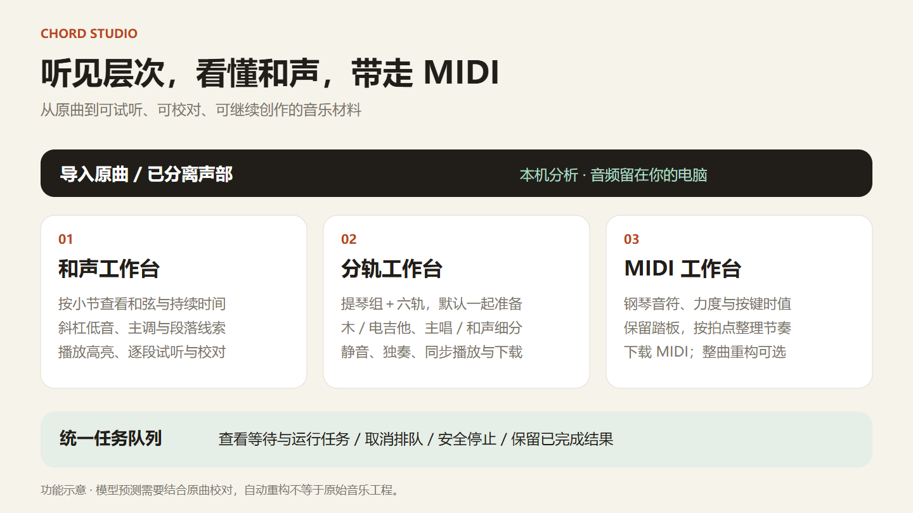
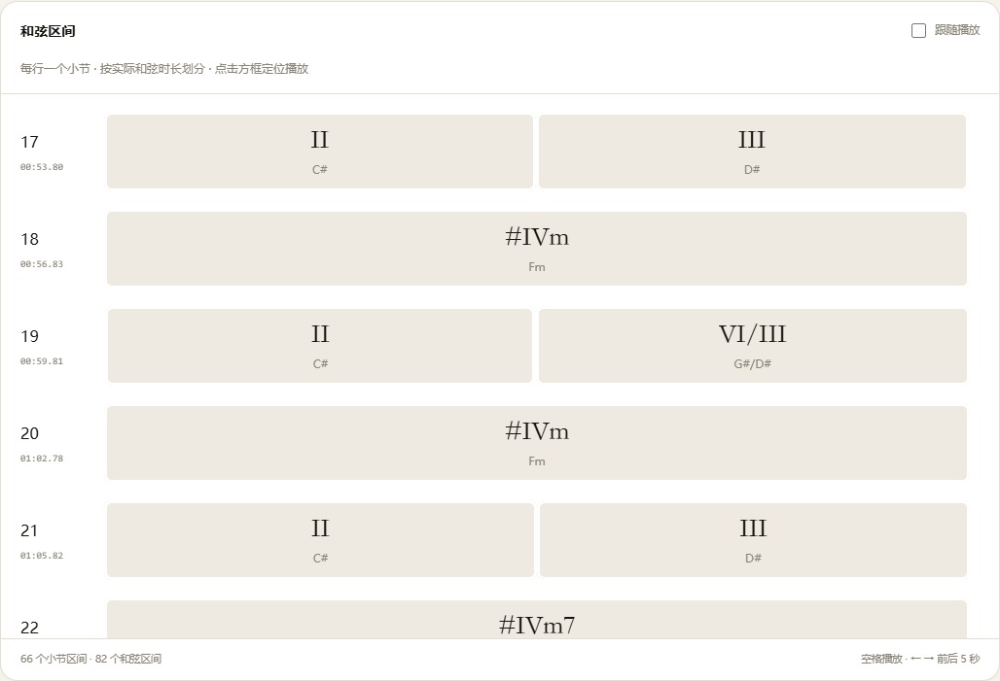
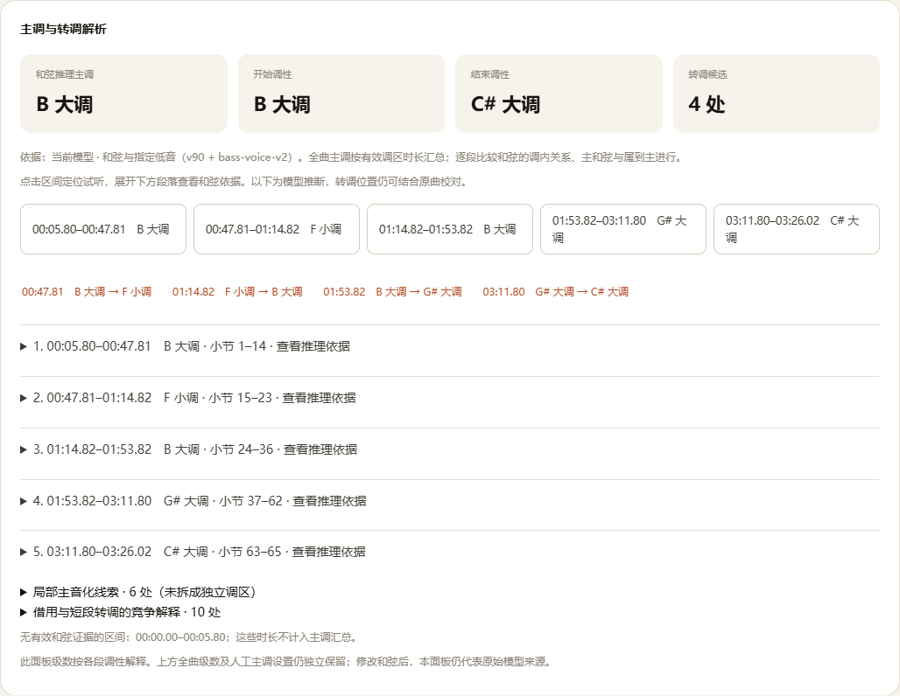
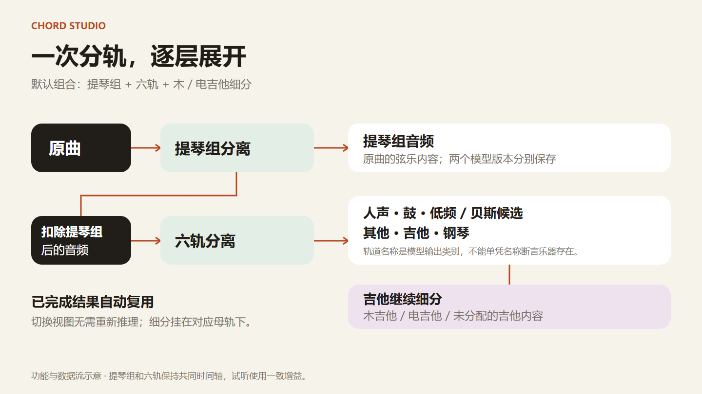
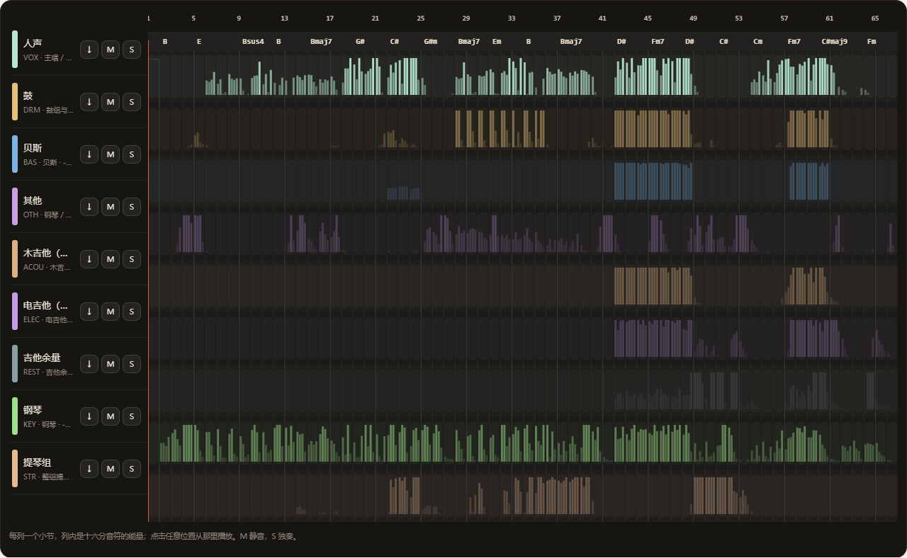
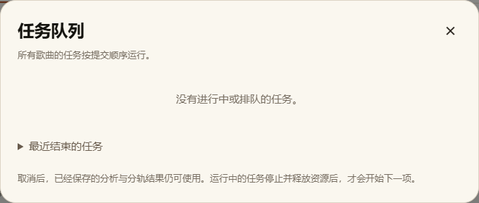
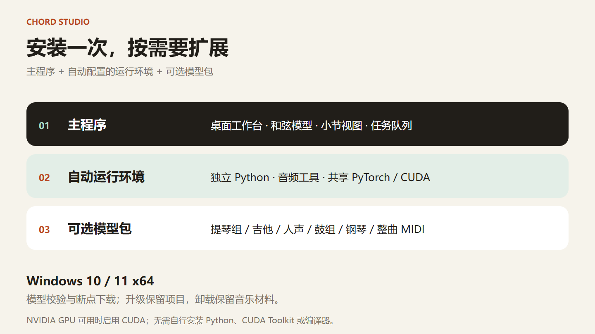
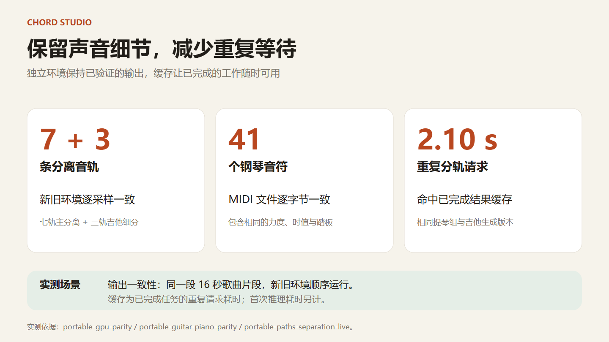

# Chord Studio

**把一首歌变成可试听、可校对、可继续创作的音乐材料。**

Chord Studio 是本地运行的 Windows 音乐工作台：按小节看和弦，分开听不同声部，把钢琴演奏转成 MIDI，再把结果带进自己的编曲软件。原曲与项目保存在本机。



## 从听歌到继续创作

| 想做的事 | 工作台提供什么 |
|---|---|
| 看懂和声进行 | 和弦名称与级数、斜杠低音、主调与段落线索；按真实起点和持续时间切分的小节视图 |
| 听清某个声部 | 提琴组、六轨、木／电吉他细分；逐轨静音、独奏、循环与同步播放 |
| 扒出钢琴演奏 | 音符、力度、按键时值、踏板与节拍对齐；下载 MIDI，继续编辑 |
| 整理多首歌曲 | 全局任务队列，查看运行与等待任务，取消排队或停止运行中的任务 |
| 保留自己的判断 | 逐段校对、独立修订、原始模型结果、LAB / JSON / WAV / MIDI 导出 |

支持导入本地音频，也支持从 B 站链接取音频。首次安装运行环境和模型，以及网络链接取音频时需要联网；对本地文件的分析和分离在本机完成。

## 按小节，看见音乐的变化

每个小节从完整区域开始，按和弦的开头和时长切割。播放时高亮当前和弦区域，点击即可从对应位置试听。支持和弦名称、级数、斜杠低音，以及人工校对。



识别采用冻结的 `chord_retained11_v90` 模型及现有时间轴处理。工作台同时保留原始输出和派生视图，并提供分轨辅助和声分析、MIDI 和声比较等探索流程。自动结果是校对的起点，保留原始结果有助于判断改动的依据。

体验版直接提供 **主调与转调解析**：查看和弦序列推断的主调、起始与结束调性、转调候选位置，并展开各段的和弦依据与竞争解释。点击段落或时间即可定位试听；推断结果与手动设置的显示主调分别保留。



## 一次准备，逐层展开声部

默认组合为 **提琴组分离＋六轨分离＋木／电吉他细分**。提琴组先从原曲中提取，六轨模型处理扣除提琴组后的音频，再对吉他轨细分。不同版本和母轨的结果分别保存，已有完整结果可直接复用。

提琴组和六轨还会分别保存已完成阶段。中途取消后重试，可以继续使用已完成的阶段；缓存会核对输入音频、模型、处理代码及文件完整性。





可选功能还包括提琴组另一版本、标准／精细四轨、人声优先、主唱／背景和声细分、鼓组细分和旋律／伴奏吉他细分。每条轨道可独奏、静音与下载，试听保持共同时间轴。

“贝斯”“吉他”等名称表示模型输出类别，不能单凭轨道名称断言原曲实际使用了该乐器。吉他余量、其他轨和混响等内容也会保留，便于继续检查。

## 钢琴与 MIDI

输入原曲或已有钢琴分轨，使用 Transkun V2 进行钢琴转写，保存力度、按键时值和踏板信息，并结合节拍分析整理节奏。原始演奏 MIDI 与节奏整理结果分别保留，方便对照试听。

整曲 MIDI 重构作为可选实验功能提供，结合分轨和不同转写模型。自动 MIDI 可以作为继续创作的材料；声部分配、漏音、串音和复杂节奏仍需要听辨与编辑。通用音源试听用于检查音符，不代表原曲音色。

## 看得见，也停得下来的任务

任何工作台顶部均可打开“任务队列”，查看所有歌曲的运行任务、等待顺序和近期结果。

- **取消排队**：移出等待队列。
- **停止任务**：停止所属的后台处理，释放资源后再开始下一项。
- 已完成并保存的分析与分轨结果继续保留。



## 安装：主程序＋自动运行环境＋可选模型



发布包入口：[GitHub Releases](https://github.com/Colin-Lv/chord-studio/releases)。请使用包含 `Install.cmd` 的 Windows 发布包；GitHub 的自动“Source code”压缩包用于开发，不包含已编译桌面程序。

1. 解压发布包，双击 **Install.cmd**（也提供无控制台入口 `Install.vbs`）。
2. 选择独立的程序目录、项目目录和需要的功能。
3. 安装程序自动准备 Python、音频工具和所选模型；完成后从开始菜单打开 **Chord Studio**。

| 安装层 | 内容 |
|---|---|
| 主程序 | 桌面窗口、工作台、任务队列、冻结和弦模型与应用代码 |
| 自动配置的运行环境 | 应用专用 Python、固定版本依赖、音频工具；有需要时安装微软 WebView2 / Visual C++ Runtime |
| 可选模型包 | 提琴组与六轨、吉他、人声、鼓组、钢琴与整曲重构所需资源 |

需要 **Windows 10/11 x64**。分轨与转写会使用可用的 NVIDIA CUDA GPU；CPU 路径可运行但会更慢。无需自行安装 Python、CUDA Toolkit 或编译器，GPU 驱动仍需由硬件厂商提供。

下载会校验文件并保留断点，重复运行安装程序可补充功能或修复安装。升级前请关闭应用，安装程序不会强制终止正在处理的歌曲。卸载保留项目目录及其中的模型，程序目录与项目目录可分别选择。

不同模型组合的空间差异较大。首次安装还需要下载缓存和解压空间，建议预留 **30 GB**，音乐项目与长期分轨另留空间。完整配置的实际占用以所选模型和安装测量为准。

组件来源和用途限制见 [第三方组件与模型说明](THIRD_PARTY.md)。其中 madmom 随附模型使用 CC BY-NC-SA 4.0；公开下载的模型不因此自动获得无条件商业授权。

## 更少重复工作，保留已验证输出



当前迁移对照使用同一段 16 秒歌曲片段：提琴组＋六轨的七条输出，以及三条吉他细分输出，新旧环境逐采样一致；钢琴 MIDI 文件逐字节一致。已有完整结果的两次重复分轨请求为 **2.59 秒、2.10 秒**，复用了相同的分离结果。

这些结果衡量环境迁移一致性和缓存复用耗时，不是整曲识别准确率或首次推理速度的基准。分轨、钢琴、重构环境共用一套安装目录内的 PyTorch/CUDA 库；同版本依赖通过本机硬链接复用，减少重复占用。

另一次 16 秒片段测试在提琴组完成后主动停止进程，重试成功复用了提琴组，七轨输出保持逐采样一致。两阶段全命中时，分离进程耗时 **3.93 秒**；强制重新推理为 **24.56 秒**，均包含该进程启动时间，不含小节分析和试听整理。独立安装后的鼓组与多乐器转写也与原环境生成了相同的 MIDI 文件。

## 构建与实现

```text
desktop/      Windows 桌面启动程序：Tauri、单实例、后台进程管理
app/          和声、节拍、结构与转写处理
app/web/      本地 API、队列、分轨与任务执行
frontend/     和声、分轨、MIDI、重构工作台
inference/    冻结和弦模型与声学前端
packaging/    安装入口、依赖锁、模型清单、校验与发布构建
tests/        接口、任务取消、时间轴、模型输入与安装测试
docs/product/ 可编辑的产品图表与生成源文件
```

开发构建先使用 Rust 构建 `desktop/Cargo.toml`，再运行 `python packaging/build_release.py --destination <空发布目录>`。桌面程序使用安装时生成的路径配置，不依赖开发者机器的磁盘布局。安装器需要的预编译 wheel 和自有适配模型由对应 Release 提供，不能只复制源码就假定资源齐全。

运行环境锁定文件位于 `packaging/requirements/`；模型和工具的 URL、大小、SHA-256 分别位于 `packaging/model-packs.json` 与 `packaging/tools.json`。发布构建按清单收集应用文件，排除用户音频、项目、缓存和本机会话凭据。
