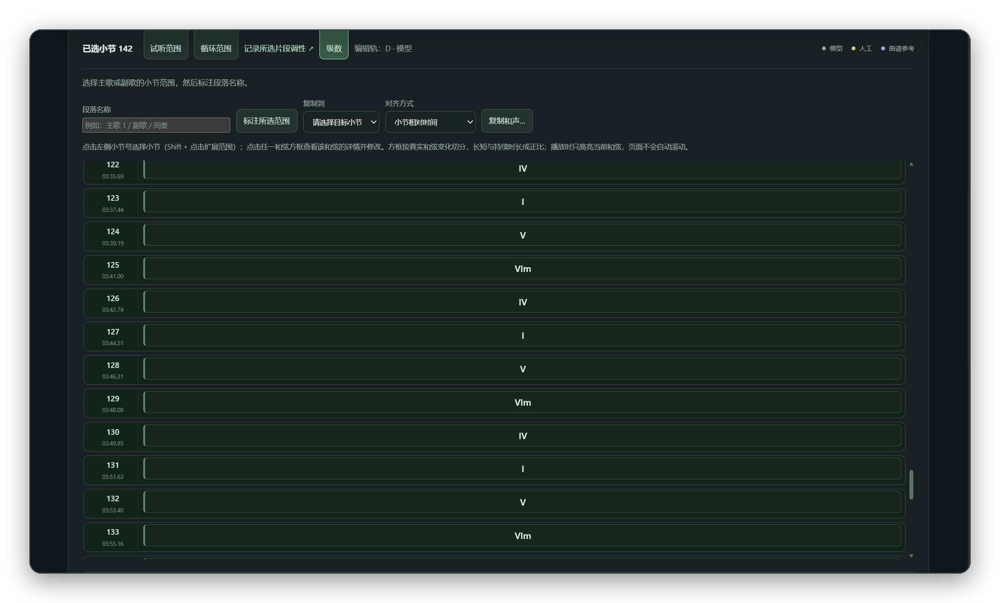
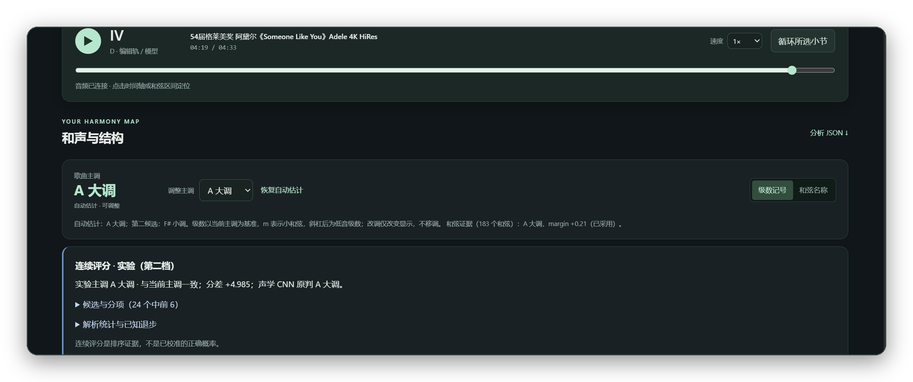
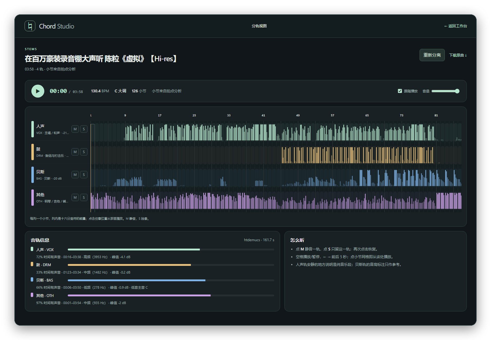

# Chord Studio

> 本地和声工作台：把一首歌拆成**和弦、主调与段落**，边听边校对。

Chord Studio 是一个 Windows 桌面应用。导入一首歌（本地文件或 B 站链接），它会在本机完成
和弦识别、主调推断、拍点与小节定位、段落与循环分析，还能把歌拆成**人声 / 鼓 / 贝斯 / 其他**
四轨，在网格里逐轨试听。音频和结果都留在本机，不上传。



<p align="center"><sub>识别完成后的和弦时间轴：一小节一个和弦，按主调显示级数，可圈选小节批量标注段落</sub></p>

---

## 功能

### 1. 导入与试听

- 拖入本地音频（MP3 / WAV / FLAC / M4A / OPUS 等，最大 512 MB，单次最长 10 分钟）
- 或直接粘贴 B 站视频链接 / BV 号，一步取音频并开始识别（支持分 P）
- 分析期间显示分阶段进度（解码 → 声学特征 → 推理 → 主调 → 拍点 → 时间轴 → 结构）
- 内置播放器：倍速（0.75× / 1× / 1.25×）、点击时间轴定位、区间循环、当前和弦实时跟随

### 2. 和弦时间轴（四种可切换）

同一首歌会给出四条时间轴，面板上一键切换，用来互相印证：

| 时间轴 | 粒度 | 用途 |
|---|---|---|
| 模型逐格输出 | 0.25 s 单元 | 看原始判断与置信 |
| 稳定时间轴 | 合并碎片、吸附小节线 | 看整体走向 |
| 小节池化 | 每小节（含半小节）一个和弦 | 看每小节的结论 |
| 完整段解码 | 整段一个和弦 | 默认视图，段界落在小节/半小节网格上 |

- 和弦库：`maj / min / 7 / maj7 / min7 / 9 / maj9 / min9 / sus2 / sus4`，以及 `N`（无和弦）
- 支持斜杠低音（如 `C/E`）与级数记号 / 和弦名称两种显示方式
- 段界对齐到小节网格，小节相位会按音频的和声变化自动校正

### 3. 主调识别

- 两种判断方式，下拉切换：
  - **连续评分**（实验）：24 个调候选统一打分，面板列出候选、总分与分项（声学证据、和声解释、
    主和弦占比、正格到达、属回次数）
  - **CNN**：声学模型直接给出 24 调分布
- 显示当前主调、来源（自动 / 手动 / 和弦证据 / 连续评分）与第二候选
- 一键采用其他证据给出的主调，也可手动选择任意调，或恢复自动估计
- 改调只改变级数显示，不移调音频；所有改调与和弦修改都单独保存，原始结果随时可下载



<p align="center"><sub>主调面板：当前调、第二候选、可调范围与分项证据；下方是同一次分析的连续评分明细</sub></p>

### 4. 拍点、小节与结构

- 拍点与小节位置来自独立的节拍模型，波形上细线为拍点、粗线为小节起点
- 段落相似性：自动标出 A/B 类重复段，帮助判断主歌/副歌位置
- 和弦循环线索：给出重复出现的进行片段，可点击跳转试听

### 5. 音轨分离

点「音轨分离」把歌拆成人声 / 鼓 / 贝斯 / 其他四轨（可换成六轨），进入分轨视图：

- 四条音轨同步播放，轨头可 **M 静音** / **S 独奏**，带独立音量
- **对照原曲** 一键 A/B（四轨静音、放原曲），**循环小节** 反复听当前小节
- 四种模型可切换：**标准**（htdemucs，GPU 约 20 秒）/ **精细**（htdemucs_ft，约 45 秒，质量更好）/
  **六轨精细**（BS-Roformer-SW，额外分出吉他/钢琴，约 1 分钟；吉他轨仍常把钢琴收进去，仅供参照）/
  **人声优先**（BS-RoFormer，两轨人声/伴奏，约 3 分钟；MUSDB 十首实测人声 SI-SDR 比标准模型高 4.7 dB）
- 网格每列一个小节、列内是十六分音符的能量块，**小节上方显示该小节的和弦**，播放头与当前小节跟随
- 自动标注：BPM 与小节网格（有拍点分析时直接复用）、每轨电平与有声占比、首次/末次出现、
  主要音区、贝斯主音；调性取自和声分析（若已做过）
- 每条分离结果都算一次**重构残差**（原曲 − 四轨之和），显示在轨道信息标题栏，用来判断有没有丢内容
- **细分鼓组**：鼓轨可以再拆成底鼓 / 军鼓 / 通鼓 / 踩镲 / 叮叮镲 / 强音镲六行，
  单独静音、独奏；镲片目前不可信，界面会照实显示电平
- 分离在 GPU 上后台进行（一首 4 分钟歌约 20–60 秒），结果按音频哈希缓存，再次打开秒开
- 无损 wav 与 192 kbps mp3 都保留：mp3 用于试听，wav 可下载



<p align="center"><sub>分轨视图：四轨同步播放，小节网格上按十六分音符显示能量，可静音/独奏并逐小节跳转</sub></p>

### 6. 逐段校对

- 和弦列表跟随播放滚动，点击任意段即可定位试听
- 直接输入和弦名称或级数修改（`C#m7`、`V7`、`6m`），可试听区间、恢复原标签
- 同时显示各来源对该段的候选，点击填入
- 修改先存在浏览器草稿里（带备份与恢复），确认后再保存为独立修订；原始模型结果永不被覆盖
- 小节视图（见首图）可按小节检查、圈选范围、批量标注段落名称与调性，模型轨与人工轨分开保存

### 7. 导出

- `analysis.json`：完整分析结果（四条时间轴、主调证据、拍点、结构）
- 原始 LAB / 修订 LAB / 修改记录：交给其它工具或脚本
- 主调审阅 JSON：调性听辨记录
- 当前草稿导出：未保存的修改也能带走

---

## 使用流程

1. **导入**：拖入文件，或粘贴 B 站链接
2. **识别**：选识别模型与主调判断方式，点「开始分析」
3. **看**：先看主调与四条和弦时间轴，再对照波形上的段落与循环
4. **听**：播放器边听边看，空格播放、左右键前后 5 秒
5. **分轨**：点「音轨分离」，完成后在分轨视图里逐轨试听、静音、独奏
6. **改**：在「复核与修改」里逐段修正，先试听再保存
7. **导出**：需要给别的工具用时导出 LAB / JSON

---

## 技术与结构

本地服务（FastAPI）+ 原生前端（无框架）+ 一组固定版本的声学模型；音频解码、特征提取、
推理、分离与后处理全部在本机完成。

```
app/          后端：识别 worker、时间轴派生、主调裁决、审阅接口
app/web/      桌面端 API 与任务队列（retained_worker / span_pool / full_decode / stems_worker）
frontend/     工作台与分轨视图（时间轴、来源切换、主调面板、和弦编辑器、FL 式网格）
inference/    冻结模型的推理入口与特征前端
research/     训练与解码研究脚本、黄金标注、验收脚本
docs/         设计说明与主调审阅报告
tests/        语义与接口测试
```

---

## 运行

桌面版以打包形式分发，双击即用；分析过程需要本机的 `ffmpeg`、`sonic-annotator` 与
NNLS-Chroma 插件，路径记录在 `desktop_runtime.json`。

源码方式运行：准备 Python 3.13 环境（`fastapi`、`uvicorn`、`numpy`、`scipy`、`scikit-learn`、
`librosa`、`soundfile`），执行 `python desktop_backend.py` 启动本地服务，浏览器打开提示的地址即可。

---

## 文档

- `docs/`：时间轴、主调与审阅的设计说明和审计报告
- `research/`：合成数据生成、60 通道训练、完整段解码与验收脚本
- `tests/`：和弦语义、主调裁决、时间轴与接口的测试


