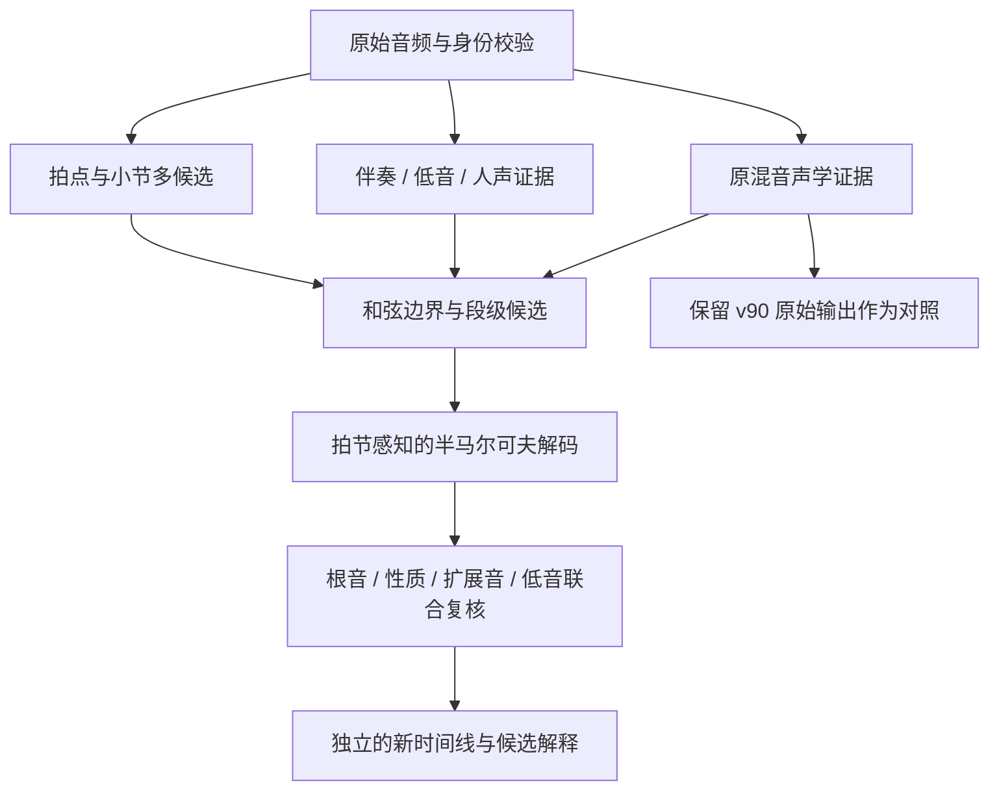

# Chord Studio 和弦过分割与旋律干扰：研究及实施计划

日期：2026-10-31。对象：已部署的 `chord_retained11_v90` / v88 音频入口，以及用户提供的《虚拟》截图和吉他谱。本轮完成文献与开源调研、部署代码复核和计划设计；没有更改生产权重或运行训练。

**建议主路线：先建立录音对齐的参考与错误分解，再加入拍节感知的段级解码；并行比较原混音、去人声、低音和伴奏证据；最后训练有边界监督、声部条件与旋律反事实约束的时序模型。** 对现有 v90 的保留或替换，由同一套独立评测决定。

这里要识别的是一段时间内稳定的和声事件，包括 Dm9、Cmaj9 等扩展和弦。不是每出现一个新音高就更换和弦，也不是把所有歌强制变成一小节一个三和弦。

## 一、问题定位：已确认、待验证与不能直接推出的结论

### 1. 已确认的实现缺口

实际部署代码位于 `C:\Users\33573\AppData\Local\Programs\Chord Studio\backend`。

| 证据 | 对问题的含义 |
|---|---|
| `inference/frontend_math.py::make_cells` 继续细分 madmom 锚段；《虚拟》缓存的 cell 时长四分位数均为 0.25 s，最短 0.05 s | 锚段不是最终和弦事件；长锚段内部有很多独立改标签的机会 |
| `inference/model/predict.py::decode` 对每个 cell 取 argmax，只合并相邻同标签 | 没有对整段和弦持续时间、拍节位置和事件序列进行联合推断 |
| 当前有局部声学上下文，但没有跨多个小节的时序表示或显式声部职责输入 | 同一伴奏上的人声、琶音与持续音变化可能被解释为新的和弦 |
| v90 quality 专家混合权重固定为 0.952574 | 没有随录音域可靠性降低该专家权重；需检查它是否放大扩展音/根音错误，不能预先断言 |
| `app/web/stabilize_timeline.py` 主要处理 0.4–0.5 s 的短段 | 持续 1–2 秒的错误标签和反复扩展音切换仍可能保留，单纯扩大阈值有抹掉真变化的风险 |

《虚拟》当前 run 为 `bc928edd2c5c460784154d969e07d499`。在稳定输出中，6.30–8.30 s 的标签是 B:min；20.28–22.12 s 依次出现 C:maj9、E:min、A:min、C:maj9。这说明需要同时处理**标签错误与边界错误**，不能仅以段数下降判定修复成功。

截图中小节起点 1.80、3.68、5.52、7.34、9.20 s 与该 run 一致；相邻小节约 1.85 s，对应当前算法的四拍约 130 BPM。曲谱只给出 4/4，未给出可核对的速度，因此需检查半速/倍速、首拍相位及录音与谱面版本。**本次没有证据确认拍速一定错，更没有将图片第 n 小节直接当成录音第 n 小节。**

### 2. 用户关于声部的判断值得验证，但还不是单一病因结论

把旋律与伴奏职责区分开，确实是合理研究方向。Cmaj9 的音级为 C–E–G–B–D，其中上方 E–G–B–D 同时构成 Em7；Dm9 的上方 F–A–C–E 构成 Fmaj7。局部只观察到上层音或漏掉低音时，多种标签都可能得到高分。这需要低音、持续时间、音符职责及上下文共同消歧。

但人声也可能唱和弦音或提供真实扩展音，伴奏本身也有经过音和琶音。乐器分离不等于自动知道“谁是旋律”；去人声不能保证和声识别改善，低音也不总等于根音。

谱面开头可见 Dm9–Cmaj9–Dm9–Cmaj9，后续还有 Em7、Am7、A7、Fmaj7。修复必须保留这些信息。若把 Cmaj9、Dm9 一律简化为 C、Dm，即使画面不抖，也未满足任务。

### 3. 本地已有实验应复用，但要修正其证据口径

已读本地 [稳定化报告](D:/ChordStudio/research/chordfix/REPORT.md) 和 [旧旋律干扰计划](D:/ChordStudio/research/melody-jitter/PLAN.md)：它们记录了短段合并、固定惩罚 Viterbi、锚段平均和分离实验。

旧报告中，固定换和弦惩罚与硬锚段平均在快速和声案例上出现明显退步。这说明需要改进代价、时间尺度与边界证据，**不能据此排除所有 Viterbi 或半马尔可夫方法**。

另有三点必须调整：

- madmom 锚点是另一个模型的猜测，不是真值；“锚内改标签”只能作为代理指标。
- 旧分离实验的输入为 `other+bass`，同时去掉了 vocals 和 drums，不能将其收益全部归因于去人声；若重新生成锚点，也同时改变了边界。
- 旧 25 首合成集已反复用于调参，只能当已知回归集；不能继续在同一批上选超参，然后称为独立泛化验证。

## 二、检索到的主要研究，以及如何采用

以下均链接论文、作者项目或官方评测；跨论文数字不直接比较，也不把论文结果当作本项目的预期收益。

| 研究 | 解决的问题与本项目用途 | 采用边界 |
|---|---|---|
| [Chen 等，Duration-explicit HMM，ISMIR 2012](https://archives.ismir.net/ismir2012/paper/000445.pdf) | 显式建模和弦持续时间；用于段级解码基础 | 不能照搬旧数据的秒数分布；本项目按拍长与局部和声节奏条件化 |
| [Korzeniowski & Widmer，Frame-Level Language Models，2017](https://arxiv.org/abs/1702.00178) | 指出复杂逐帧语言模型不一定带来音乐序列收益 | 不把“给每个 0.25 秒格加个 LSTM”当成充分修复 |
| [同作者，Duration and Harmonic Language Models，ISMIR 2018](https://arxiv.org/abs/1808.05335) | 分开建模事件序列与持续时间 | 为短期解码器和后续事件级语言先验提供依据 |
| [Harmony Transformer，ISMIR 2019](https://archives.ismir.net/ismir2019/paper/000030.pdf) | 联合预测和弦分段与内容 | 借鉴边界监督；其后续 HTv2 主要验证符号输入，不能直接当作真实混音结论 |
| [Large-Vocabulary Chord Structure Decomposition，ISMIR 2019](https://github.com/music-x-lab/ISMIR2019-Large-Vocabulary-Chord-Recognition) | 分开预测三和弦、低音、7/9/11/13 等结构 | 适合检查“根音稳定、质量乱跳”，本地已有相关桥接代码 |
| [Kim & Park，Event-based ACR，ICASSP 2026](https://arxiv.org/abs/2604.24386) | 直接预测时间戳与和弦事件，专门针对过分割和复杂和弦 | 与本问题最直接匹配；用于长期模型原型和事件表示设计 |
| [BACHI，ICASSP 2026](https://andyweasley2004.github.io/BACHI/) | 边界感知，按置信程度迭代推断根音、质量、低音；提供 POP909-CL | 是符号乐谱模型，适合标签准备和设计参考；不能直接输入 MP3，也不能把转写错误忽略 |
| [ChordFormer，2025](https://arxiv.org/abs/2502.11840) / [作者代码](https://github.com/mwaseemrandhawa/ChordFormer) | Conformer 上下文与结构化和弦头 | 列为较强声学对照；仍要单独检查边界和扩展音，不假设换骨干即可解决 |
| [SheetSage2，2026-10 技术报告](https://arxiv.org/abs/2610.05336) / [官方模型](https://huggingface.co/m-a-p/SheetSage2) | 合成监督、结构解码、自回归蒸馏，联合输出可读乐谱事件 | 本地已有固定 revision 桥接，优先做整曲对照；缩短上下文须标为非官方配置 |
| [Jointist，2023](https://arxiv.org/abs/2302.00286) / [作者代码](https://github.com/KinWaiCheuk/Jointist) | 联合乐器识别、多乐器转写与分离，并研究和弦等下游任务 | 支持“声部感知”的方向；较重，且乐器类别不等于和声职责，不作为第一步依赖 |
| [Yoshida 等，Source Separation and Remix，2026](https://doi.org/10.1007/978-3-032-30573-2_24) | 利用分离声部动态调整对和声有用的证据 | 本次核对到摘要，未复现完整实验；适合作为多路融合动机，不采用其未验证的实现细节 |
| [Beat This!，ISMIR 2024](https://arxiv.org/abs/2407.21658) / [作者代码](https://github.com/CPJKU/beat_this) | 音频拍点和强拍估计 | 用作 madmom 之外的拍格候选，不能把单个 tracker 输出强制当真值 |
| [Cho & Bello，Recurrence Plots，ISMIR 2011](https://ismir2011.ismir.net/papers/OS8-4.pdf) | 用重复结构改善和声特征 | 后期做重复乐段证据共享；只作软证据，保护末次副歌改和弦和转调 |
| [Revisiting Two-Stage ACR，ISMIR 2026](https://ismir2026program.ismir.net/poster_266.html) | 多音高估计接符号和声预训练 | 可探索中间音符表示；主实验偏古典，作者也说明流行曲和 N 的验证局限 |
| [20 Years of ACR，ISMIR 2019](https://archives.ismir.net/ismir2019/paper/000004.pdf) | 综述表示、时间上下文、标签歧义与旋律/和弦解释差异 | 据此明确标注目标，避免将某种谱面简化当作唯一声学真相 |

2026 年 [MIREX 官方结果](https://www.music-ir.org/mirex/wiki/2026%3AAudio_Chord_Estimation_Results) 同时列出 ChordFormer、MuQ-BTC、SLASH 等，并分别报告根音、七和弦、低音与分割指标。不同系统的优势不同；MuQ-BTC 的训练集重叠、SLASH 的部分调参重叠也有注明。因此本项目应复用其多维评估方式，而非按单一总分直接选替代品。

## 三、开源方案的实际可用性

检索/仓库检查时间均为 2026-10-31。本次未下载大权重、安装环境或执行第三方训练。

| 项目 | 核对结果 | 使用顺序 |
|---|---|---|
| [BTC-ISMIR19](https://github.com/jayg996/BTC-ISMIR19) | MIT；仓库中有 `btc_model.pt` 和 `btc_model_large_voca.pt`；检查 commit `2682317be668032e6e4b269ded36adaa2ad57df0` | 尽早建立独立音频对照；先检查其实际词表能否区分目标 9 和弦 |
| [ISMIR2019-Large-Vocabulary](https://github.com/music-x-lab/ISMIR2019-Large-Vocabulary-Chord-Recognition) | MIT；仓库有五折 `.sdict`；commit `481f4ce703f8822b99f4037e9104ba1760e21ea3` | 优先复用本地前端/后验桥接，避免重复搭建 |
| [Beat This!](https://github.com/CPJKU/beat_this) | 官方代码及权重公开，MIT | P0/P1 拍格对照 |
| [Demucs 作者维护库](https://github.com/adefossez/demucs) | 代码 MIT，权重许可另述；原 facebookresearch 仓库已归档；支持分块 | 先复用已安装版本和缓存；分离结果与 checkpoint 哈希固定 |
| [ZFTurbo/Music-Source-Separation-Training](https://github.com/ZFTurbo/Music-Source-Separation-Training) / [BS-RoFormer](https://github.com/lucidrains/BS-RoFormer) | 开放训练/推理实现及多种模型接入；分离质量须按下游和弦指标评价 | Demucs 的补充对照；具体 checkpoint 单独冻结，不自动更换最新权重 |
| [ACR_seq2seq](https://github.com/KimLeekyung/ACR_seq2seq) | 有 25 个文件及训练代码；commit `96f5d8c15eacff7da7f24eff61252393f205e5d6`；当前树未见 checkpoint，GitHub 未识别许可证 | 研究参考/复现候选；不是已确认可下载即用的产品替代 |
| [ChordFormer 作者仓库](https://github.com/mwaseemrandhawa/ChordFormer) | commit `77bec5136503c406e34f223f2c9b013f24c80862`；README 说有五折 checkpoint，但此次递归文件树未见 `.sdict`；代码默认 GPU 5，需适配 | 先解决权重实际可获取性及运行配置；不把同名吉他分类仓库误当论文实现 |
| [BACHI](https://github.com/AndyWeasley2004/BACHI_Chord_Recognition) / [POP909-CL](https://github.com/AndyWeasley2004/POP909-CL-Dataset) | MIT 代码，提供预训练权重链接，输入 MIDI/MusicXML；训练以钢琴数据为主 | 标签审查、符号基线和合成监督；不当作录音真值生成器 |
| [SheetSage2](https://huggingface.co/m-a-p/SheetSage2) | 官方模型与代码可用，CC-BY-NC-4.0；本地桥接当前固定 CPU | 独立研究对照；如迁移 GPU，另建环境，不直接改生产依赖 |
| [Jointist](https://github.com/KinWaiCheuk/Jointist) | 作者提供权重链接；原环境为 Python 3.8 / 旧 CUDA 工具链 | 后期声部/音符诊断；先测兼容性与资源再决定是否接入 |

资源实测：`nvidia-smi` 显示 **RTX 4050 Laptop，6141 MiB 显存**。因此“本机没有 GPU”的旧记录不应沿用。短期 DP/缓存实验用 CPU；分离分块串行运行；小型 TCN/Conformer 试验用 AMP 和梯度累积。先做 30–60 秒资源探针再推算整曲时间，不承诺所有第三方模型可在 6 GB 上原配置运行。

## 四、目标架构

**先判断一段是否保持同一和声，再综合整段证据判断是什么和弦。** 边界与标签可以迭代修正，不能早早硬锁错误边界或错误根音。

### 4.1 段级解码器：第一项实际修正

初期直接读取现成 `posterior.npz`、`cells.json`、`notes.npz`、`beats.json` 和原始 LAB，不重新训练 v90。新增研究模块 `harmonic_segment_decoder.py`，接口显式传路径与版本，不读取曲名、参考谱或测试标签。

对候选分段 S 使用以下工程设计（不是声称来自某篇论文的原式）：

\[
Score(S)=\sum_{s\in S}\left[\sum_{i\in s}\Delta t_i\log q_i(c_s)+\lambda_d\log P(d_s^{beat}\mid h_s)+\lambda_b B(start_s)\right]+\lambda_t\sum_s\log P(c_s\mid c_{s-1}) .
\]

- `q_i(N)=p_i(N)`；`q_i(c)=(1-p_i(N))p_i(c|非N)`。先统一 N 与和弦的概率口径，再在校准集检查温度缩放；不直接把原始分数称为置信度。
- 发射证据按实际秒数/拍长积分，防止 0.05 秒格与 0.25 秒格被等权计数。不要把不同长度段的“平均分”随意相加，否则改变分段数本身就会改变目标。
- `d_s` 使用拍数；时长先验覆盖半拍、1、2、4、8 拍等多种模式，同时保留非整数拍与自由变化的概率。局部和声节奏 `h_s` 可随段落变，不为整曲锁定“四拍换一次”。
- `B` 综合拍位、低音/伴奏变化、和声新颖度、独立边界模型。madmom 锚点只是一个特征；人声起音、鼓填充、后验跳变都不能单独触发边界。
- 首版用弱转移先验；不强制调内和弦，不屏蔽副属、借用、离调和弦。较强语言模型放在后期且单独消融。
- 候选边界取 cell 边界、拍/半拍位置、声学变化点的并集。拍位落在 cell 内时，初版按重叠时长分配证据；后续可以重新提取局部特征以提高时间分辨率。
- 保留锚内、弱拍和切分位置的自由边界路径。不能为“对齐小节线”把可靠边界强制移动 250 ms；记录原声学时间与谱面拍位两种坐标。
- 结构头不能先硬选根音再丢弃其余候选；保留 root/quality/bass 的 top-k 联合候选，允许后续低音和时序证据纠错。

### 4.2 声部证据：分离后做可靠性融合

第一轮比较 full mix、仅去 vocals、仅去 drums、bass+other、bass-only 五种输入。`bass-only` 用作低音证据诊断，不能要求它识别完整质量。所有 stem 维持原采样时钟和相对增益，核验分离引入的位移；避免各 stem 独立归一化后改变相对音量。

采用两种实验口径：固定同一原混音候选网格，隔离声学证据效果；允许每路重新生成网格，测端到端效果。后者不能被解释为纯粹“去人声收益”。

先试小规模验证集上的固定凸权重，再考虑训练质量门控。分离质量差、低音弱、原混音提供可靠扩展音时，应回退或提高原混音权重。使用 soft mixture 或经校准的融合，不把高度相关的多路模型当独立证据无上限叠加。

声部特征至少包含：低音候选及持续性、伴奏音级支持、强拍起音、段内持续/重复音、主旋律音高运动、人声活动，以及各路模型的分歧。HPSS 可作低成本基线，但“谐波成分”仍包含人声与旋律，不等于伴奏分离。

### 4.3 事件级与声部感知模型：中期修正

在冻结前端特征上先训练小型 TCN 或双向时序编码器，以 4–16 拍、多小节上下文为起点；输出和弦变化、根音、三和弦族、7/9 等扩展、低音、N。利用段内 pooling 形成事件表示，再接段级解码器。

损失包括标签监督、边界监督、段内一致性与反事实一致性。边界任务处理正负样本不平衡；扩展音只在有可靠标签时监督，未标注不能当作“确定没有 9 音”。N 与未知/不可判别分别处理。

反事实样本保持同一伴奏及和声事件，只改变人声/旋律的音量、音色、旋律线、非和弦经过音、琶音密度、混响。对这类配对鼓励主和弦与边界一致。另建真实质量变化、转位、换低音及扩展音变化的反例，要求模型保持敏感；不能把任何旋律变化都训练成可忽略。

进一步比较 event seq2seq 与小型编码器+段级解码。前者需验证时间戳单调、长曲窗口拼接、事件遗漏及自回归错误传播。模型自己输出更少事件，不代表结构已经正确。

## 五、分阶段执行与交付

下面是工作量估计，按有效开发日计算，不是完成时间承诺；数据标注与第三方权重可用性是主要变量。

| 阶段 | 工作 | 交付与进入下一阶段的条件 | 估计 |
|---|---|---|---|
| P0 基线与参考 | 固定 v80/v80-on/v90/raw/stable；核对《虚拟》版本、谱面与拍格；建立参考边界和层次标签；完成错误分解 | `protocol.json`、录音对齐参考、逐小节诊断；能区分拍格错、根音错、扩展音错、边界错 | 2–4 日 |
| P1 事件解码 | 实现持续时间/拍位/边界软约束；与逐格、现有 stable、硬整小节、固定惩罚 Viterbi 比较 | 新 `retained10_segmental` 来源及消融报告；快速和声与复杂和弦不被明显压平 | 3–5 日 |
| P2 声部与替代模型 | 同网格分离实验、多路融合；BTC/大词表/可用 ChordFormer/SheetSage2 独立对照；拍格多候选 | 分离和模型贡献各自可归因，选出质量/速度可接受的候选 | 3–6 日，可与 P1 重叠 |
| P3 时序训练 | 人工真实片段+经审查合成配对；训练边界感知时序头、结构头与反事实目标 | 未见作品上的结果超过 P1/P2；如无增益则保留较简单方案 | 5–10 日起，取决于数据 |
| P4 集成与冻结 | 新来源接入桌面、保留候选与修改理由；校验缓存/版本/低音保真；封存评估 | 发布新命名制品、完整 manifest、可回滚配置与回归报告 | 2–3 日 |

首个有用交付应是 **P0+P1 的可对照时间线**。P2 若显示已有模型明显更好，可优先集成胜出的声学模型与同一解码器，不为维护 v90 架构而无限增加补丁。

### P0 的四个诊断实验

1. **人工边界 + v90 段内证据**：检验给定正确边界后，标签是否仍然错误。若 Cmaj9 的整段证据仍偏向别的根音，平滑不足以修复。
2. **当前边界 + 参考标签的最佳匹配诊断**：检查网格是否能够表达真实变化；这是 oracle 诊断，不算自动识别成绩。
3. **人工拍格 vs madmom vs Beat This! vs 半速/倍速候选**：单独量化节拍尺度和首拍相位问题，避免错误拍格污染时长先验。
4. **原混音/声部 × 固定网格/自由网格 × 原解码/段级解码**：用受控消融拆开声学、边界与解码收益。

《虚拟》及用户给出的谱面属于开发案例，应将其开头与主歌至少 16–32 小节做细致对齐。谱面可能是改编，应先确认和弦与当前录音一致；存在歧义就保留候选及标注说明。用户看过预测的区域标为 review-assisted，不伪装成盲标测试。

## 六、数据与评估协议

### 6.1 数据分层

- 已有 25 个 chordfix 合成片段、旧 POP909 渲染、用户已反复讨论的歌曲：固定为 known-regression/development。
- 新增真实录音初始目标：约 30 个不同作品，每曲覆盖前奏/主歌/副歌等 2–3 个 20–40 秒片段。建议 15 个作品训练、5 个开发、5 个校准、5 个封存，仅够试点；若封存不确定性过大，扩大作品数后再发布。
- 各分区按作品和录音分组；同曲不同 cover、stem、变调、速度变体及合成版本不得跨组。对已有 v90 训练清单和上游可知训练集做重叠检查；无法排除上游见过的样本需明确标注。
- 风格覆盖一小节一和弦、半小节、逐拍、切分提前换、3/4、6/8、真七/九和弦、slash、借用/副属与 N。不能只挑容易稳定的慢歌。
- 优先使用 [POP909-CL](https://github.com/AndyWeasley2004/POP909-CL-Dataset) 辅助审查符号标签；原 [POP909](https://github.com/music-x-lab/POP909-Dataset) 的三轨可用于角色控制，但其音频和弦抽取标签不自动等于人工真值。
- [MedleyDB](https://steinhardt.nyu.edu/marl/research/resources/medleydb) 等真实多轨可做分离与配对诊断，但需要补和弦参考；不能把已有旋律或乐器活动标注当和弦标签。

合成数据须有正确和弦事件、拍格、声部角色和渲染时间对齐。跨音源/音色族分割，增加真实乐器采样与不同混音；不能只扩充当前单一波表合成器的数据量。对复杂扩展音另建人工可验证的小型探针。

### 6.2 指标

| 维度 | 必须报告的指标 |
|---|---|
| 和弦正确性 | 时长加权 root/majmin/triads/sevenths/bass 与严格完整标签；逐曲 macro 和全时长 micro 都报 |
| 扩展音 | 7/9/sus 的分项 precision/recall，以及 Cmaj9→Cmaj、Dm9→Dm 等降级次数 |
| 分割 | OverSeg、UnderSeg、Seg；边界 precision/recall/F1，分别在 50/100/200 ms 与拍长相对容差下统计 |
| 用户问题 | 人工确认“一小节一和弦”区域内的伪边界/小节、正确整小节标签率、人工删除/合并/改标签次数 |
| 保护能力 | 真实逐拍/半拍/切分边界保留率、同根音真实质量变化召回、转位保真、N 的误触发与漏检 |
| 声部鲁棒性 | 固定和声的旋律反事实标签变化率和伪边界数；真实改变和声时的敏感度 |
| 工程 | 整曲耗时、CPU/RAM/GPU 峰值、失败率与回退、冷缓存/热缓存分别测 |

使用 [mir_eval 官方定义](https://mir-eval.readthedocs.io/latest/api/chord.html)：OverSeg/UnderSeg 是越高越好的得分，不能把它们与“碎片数量越低越好”混淆。标准七和弦等约简指标不能充分区分 7 与 9；本任务必须额外保存完整结构标签，并单独衡量 9 音，而非仅报 maj/min 准确率。

同一个和弦延续两个小节，可以是一条持续事件在 UI 跨两小节展示；每小节重新扫弦不等于和弦类型发生变化。标注“和弦事件边界”与“重新起音/小节线”应分开。

### 6.3 建议的验收门槛

以下是待 P0 冻结的**工程目标**，不是已有成绩或文献承诺：

- 在确认单和弦小节的真实片段上，相对当前 stable，伪边界数减少至少 70%；正确整小节标签率同时提升。
- 封存集完整标签时长正确率至少不退步，root/质量/N 分项无显著伤害；按作品 bootstrap 报告区间。试点样本太少，无法确认非劣时应报告不确定并扩充数据。
- 快速/切分保护集边界 recall 相对当前最佳基线下降不超过 2 个百分点；复杂质量和 slash 指标不能因简化而“换取稳定”。
- 已知困难集出现单曲明显退步（建议 >2 个百分点）必须逐例解释，不用整体均值掩盖。
- 将算法输出随机排序进行试听/编辑比较，记录修订操作和耗时；主观“更整齐”只作辅助指标。

调参只看开发集，校准只看校准集；封存集一次性评价选定候选。如需再改模型，旧封存集转为回归集，另建新的封存集。

## 七、实施文件与集成边界

建议新研究目录：`D:\ChordStudio\research\harmonic-segmentation-v1\`。以下为计划创建的文件，尚未实现：

| 文件 | 责任 |
|---|---|
| `freeze_protocol.py` / `protocol.json` | 输入哈希、录音/作品身份、数据分区、标签口径、超参搜索范围 |
| `audit_xuni_alignment.py` | 谱面—录音—拍格对齐和错误类型统计 |
| `build_boundary_candidates.py` | 多来源边界、网格置信度及自由时间路径 |
| `harmonic_segment_decoder.py` | 持续时间与拍位感知的段级 DP |
| `extract_role_evidence.py` | 分离/原混音的时钟、增益、音符与低音证据 |
| `train_boundary_context.py` | 小型时序编码器、边界与结构头 |
| `build_counterfactual_pairs.py` | 保持和声与改变和声两类配对，均追踪作品身份 |
| `run_ablations.py` | 固定网格/自由网格、声学/解码、结构头/语言先验的独立对照 |
| `evaluate_harmonic_events.py` | 标签、分割、复杂和弦、反事实与编辑负担统一评测 |
| `export_review.py` | 原始/现有稳定/新段级时间线、候选理由及试听定位 |

桌面集成首先只增加 `retained10_segmental` 或新的正式模型来源，不覆盖旧 `retained10` 和人工修正。界面显示整段和弦、可展开局部候选；对不确定扩展音给明确候选，不让每次暂态候选变成一次正式换和弦。

缓存按原音频哈希、分离模型与参数、前端版本、时间网格和模型权重共同标识；标签/后验缓存和音频特征缓存分层。每次生成新运行目录，固定样例、模型组件来源、代码 revision 和权重哈希；修复上一轮发现的 slash 低音保真与打包缺种子问题。

## 八、决策顺序

1. 若给定正确边界后标签基本恢复，先交付 P1；无需立即重训大模型。
2. 若原混音差、伴奏/低音证据好，优先 P2 融合及声部分布适配。
3. 若固定边界和多声部下仍频繁根音/质量错误，优先 P3 的表示与结构头，或替换为对照中更可靠的声学模型。
4. 若新模型仍错但谱面对应的音频证据不足，保留不确定候选；不让语言模型凭常见进行补造“看似合理”的和弦。

最近一轮应该完成的具体闭环是：**《虚拟》16–32 小节对齐参考 + 全部基线诊断 + 段级解码原型 + 快速/复杂和声保护测试 + 同界面试听对照**。完成这个闭环后，再决定声部分离和重训投入。
